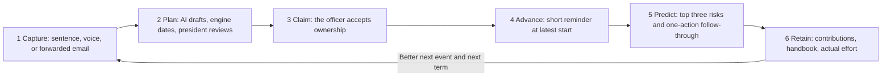

> **Current guidance:** all repository records and GitHub collaboration must be in English. Read current `AGENTS.md` and PROGRESS before interpreting the dated decisions below.

> **November 26, 2026 — Playbook phase 1 feedback (Juanxi's decisions):** compact, direct Q&A rows like a corporate FAQ instead of large open blocks; answer kinds renamed for clarity (School rule, Club rule, Tip); no hiding anywhere: the president or VP deletes outdated answers or questions; the Playbook is open to every role (no role filter on visibility); authors shown by full name; Ask AI hands Ask a structured question context (rules, club rules, tips) for a future AI harness; rows read left to right with a tinted category tag before the question and icon buttons on the right like Rules (Juanxi's option b); category chips never shift when selected.
>
> **November 25, 2026 — Playbook integration (Juanxi's decisions):** path 2: a new **Playbook** page replaces Handoff in the navigation, handoff becomes a mode inside it and `/handoff` redirects; questions expand in place with a small Ask AI button opening the right-rail Ask (approved exception, recorded in AGENTS.md §6); the Playbook word limit is acceptable for now but must stay bounded as experience grows or is replaced (answers rendered only when opened, at most 8 questions per category before "Show more"; `/playbook` 200 visible / 600 total replaces `/handoff` 120/120); phase 4 keeps interfaces and architecture only and is connected in a later conversation. Delivery is phased with worktree agents: [integration plan](feedback-fix/PLAYBOOK_INTEGRATION_PLAN.md). All visible policy IDs now show source names (`f31cfbc9`).
>
> **November 25, 2026 — Experience library v2 details (Juanxi's decisions):** answer types are told apart by label text colour only (school rule, club practice, experience), never by large coloured blocks; the guess-before-reveal option is removed; "helpful" becomes like and dislike buttons; **everywhere in the system, show a policy source's name (for example "Student Club and Organization Handbook 2026-2027") instead of record IDs such as ASU-R-038** (IDs stay internal). Experience from other clubs at the same school may outrank the club's own when it is more useful. Contribution points: reviewed by Platypus's own student team, not school staff; used mainly to bootstrap the school's experience library early, with diminishing value per contribution and a per-club cap per term so the total cost is predictable; preferably redeemed as credit on the next Platypus bill (gift cards only if Platypus pays, never USG-T funds). Prototype uses fictional points only. Design page: https://claude.ai/artifact/JezotTwt9qXUGsd3K6qJKa.
>
> **November 25, 2026 — Experience library direction (Juanxi's decisions):** of the four options in the three-day analysis Juanxi keeps **A (the president's own checklist)** and **C (experience)**; no in-flow checking (clubs' processes differ), no meeting notes or conversation agendas (the president confirms one-to-ones in the checklist). Platypus provides tools, not a mandatory template. Handoff becomes an **experience library** used all year; handover and onboarding are two steps inside it. School policy is updated every academic year. Design options for the library (question layers, experience cards, policy links, new-officer questioning) are under review: https://claude.ai/artifact/GkhtWwELPgyd72FEd5wfAF.
>
> **November 24, 2026 — Onboarding roadmap and checklist template v2 (Juanxi's decisions):** the checklist does not replace Handoff: Handoff reads this template when a role's handoff starts. Three phases: (1) personal checklist from the template; (2) predecessor handoff module that can produce a 1–2 page handoff document so a new officer takes over quickly; (3) AI woven into the whole process, answering checklist and policy questions first so small problems do not wait for the president. Template v2 before phase 1: drag to reorder items and modules; remove "Who does it"; a colour per module; "+ Add item" in each module header instead of the toolbar; a team row above the roles, read live from Roles & teams; remove the "From Everyone" state (role cells are on or off). [Contract section 8](feedback-fix/CHECKLIST_MATRIX_CONTRACT.md).
>
> **November 23, 2026 — Onboarding checklist editor (Juanxi's decisions):** handoff direction is option 2 (handoff packet) plus option 6 (AI coaching), built on a checklist first. The checklist item has only three fields: title, when, who does it; when and who follow the item's module unless set on the item ("Checked by", "Proof" and "Applies to" removed). Modules are fully user-defined. The president sets the whole-club list first, then adjusts by role. Of four mockups Juanxi chose **option C, the matrix** (one row per item, one column per role) and asked for worktree agents to build it. First package: Settings → Onboarding editor, starter, paste, shorthand, Undo; no officer-facing instance, Handoff integration or AI yet. Optional `Org.onboardingChecklist`, so `SCHEMA_VERSION` stays 23. [Contract](feedback-fix/CHECKLIST_MATRIX_CONTRACT.md), [mockups](prototypes/onboarding-checklist/README.md).
>
> **November 23, 2026 — S4–S7 (Juanxi's decisions):** S4 (Handoff simplification) is skipped for now. S5 archives only the Help page (like Partners: moved under `src/archive/`, `/help` returns home); Team, Rules, View as and the other S5 proposals stay as they are. S6 (shorter first-time setup and slimmer Settings) and S7 (site-wide copy pass with the five copy rules) start now. Research recording and exports stay intact while decision D5 remains open.
>
> **November 23, 2026 — S3 Plan page simplification (Juanxi's decisions):** funding stays unchanged for now (Budget line items, the Funding rail and "$ requested" remain; a better design comes later). Tasks keeps only the Table list (default My tasks); the Board (with drag and per-column quick add) and the Timeline are removed, and owner/due are edited only in Task Details. Per-event flow editing on Events stays. Status customization is removed: the six statuses (Not claimed, To do, Working on it, Waiting, Stuck, Done) and their colors are fixed; saved custom names stay in the data but are no longer shown. Events drops its List view and gains a short "Next up" strip under the Flow. Removed code is restorable from git: each S3 work package has its own merge commit, and `docs/history/S3_RESTORE.md` lists what went where.
>
> **November 22, 2026 — S2 Reminders home simplification (Juanxi's decisions):** keep all three sending modes (`auto_email`, `review_then_self`, `review_then_auto`); simplify only the page. Old saves upgrade their reminder plan automatically on load, reset and import, preserving settings and history; this supersedes the November 16 rule that old saves upgrade only when a lead presses "Enable updated reminders", and that card is removed. Each person row expands in place to show the full email, with the mode's action beside it (Send; Open in Gmail and I sent this; or status only), and one Send all at the top for "I review, Platypus sends". The onboarding Reminders screen is removed (founder flow 8 → 7 screens, record format `ob-5`); new clubs and the sample club default to `review_then_auto`, existing saves keep their choice or lack of one, and Settings still offers all three modes.
>
> **November 22, 2026 — S0/S1 from the subtraction review:** only event creators who are current officers may change an event's date, name or headcount (Event Details stay open to all officers); unreachable prototype code and endpoints were removed with no other visible change. Details in `docs/PROGRESS.md`.

> **November 19, 2026 — Partners archive and Team navigation:** Juanxi requested temporarily hiding standalone Partners. Move its page, dedicated CSS, and tests to an archive; retain business code, contacts, organizations, interaction history, and shared Handoff details. Old Partners URLs return home. Put Team directly in primary navigation and hide an empty More menu. Continue Preview 14. [Archive/restoration](../src/archive/partners/README.md).
>
> **November 18 — one-/two-day milestone spine, approved for Preview 14; supersedes earlier dot-editor details:** offer only 1-day and 2-day, without 3-day. The main path is Start → shared tasks → separate Event day milestones → Done. Team branches save explicit start/join endpoints and may occur before, between, or after event days; a team may own multiple intervals. Select existing organization teams; do not create Team N or rename teams from the canvas. All virtual endpoints, milestones, shared tasks, and ordinary tasks open editable Details. Full check remains a real task; Event day becomes a fixed-date milestone. The engine calculates relative-Day-1 targets and reports unfinished prerequisites as risks without moving event day. ASU hard limits stay relative to Day 1. New version/runtime snapshots may store `milestoneGraph`; do not rewrite old events. Preserve Quick entry, Undo, conditions/roles/teams, drafts, and versions. [Contract](feedback-fix/WORKFLOW_MILESTONE_CONTRACT.md).
>
> **November 18 — earlier dot-based team lanes; later milestone contract above takes precedence:** use dots, gray tracks, translucent team backdrops, and fixed virtual Start/Done. Add branch originally created an organization team/empty parallel lane; Add task created a task. Repeatable Full check/Event day presets had stable IDs. Moving across teams changed `teamMap`, preserving role, conditions, dependencies, and dates. New drafts/versions used `teamExecution:dependencies`, without automatically chaining every task in a team. Preserve published sequential versions and existing snapshots; validate explicit dependency edits for cycles/school rules. Dense lanes wrap within one backdrop; retain zoom/fit and full Details. Plan keeps actual task dots. [Contract](feedback-fix/WORKFLOW_DOT_EDITOR_CONTRACT.md).
>
> **November 18 — earlier compact sequential lanes; superseded by the dot/milestone decisions above:** fixed 132×52 cards show one-/two-word labels plus one T-minus/T0/T+ tag; full name, Details, owners, and workdays stay in the rail. One row/sequential chain per organization team, parallel between independent teams. Remove Add parallel/Quick entry Parallel; insertions inherit team/category/business branch. Drag order, edit dates in Details. Route short orthogonal lines between actual card ports; horizontal position expresses dependency order, not calendar scale. New `teamExecution:sequential` drafts/versions scheduled finish-to-start with effort/personal buffers, never relaxing ASU limits or concealing infeasibility. Do not add chains to old published versions or Plan snapshots. [Handoff](feedback-fix/WORKFLOW_STABILITY_HANDOFF.md).
>
> **November 18 — reminder entry corrected against actual screenshots:** use Events' real workflow plus Details, rather than the Tasks board. New and reusable older officer/Tasks links enter Plan → Events. Associated tasks use their own `eventId`, regardless of the most recent event. Unassociated Club tasks retain their original Details; show the workspace's last viewed event, or first event, only as switchable reference context without changing task association. Other nodes expose submitted work; returning restores the original draft. Ordinary Tasks defaults to My tasks. [Current handoff](feedback-fix/REMINDER_PLAN_ENTRY_HANDOFF.md), PR14.
>
> **November 18 — earlier Club-task routing patch, superseded above:** the unassociated “Draft the meeting agenda” example originally opened Plan → Tasks with the original task rail and switching/return. Associated tasks used their actual event Plan. Preserve ownership, grants, autosaved drafts, and submitted/read-only boundaries; do not invent an event association. The later Events routing changes only this navigation choice. [Handoff](feedback-fix/REMINDER_PLAN_ENTRY_HANDOFF.md).
>
> **November 18, America/Phoenix — default teams:** restore Club leadership, Operations, Marketing, and Finance from the v3 grouping; the 46 tasks distribute 1/25/8/12. Establish defaults automatically, retaining stable IDs, arbitrary future renaming/addition, explicit existing settings, and event snapshots. This supersedes requiring manual team confirmation before using the standard template. [Implementation](feedback-fix/WORKFLOW_BUILDER_IMPLEMENTATION.md).
>
> **November 18 — approved reminder Plan entry:** locate an event task's actual event and node in right-side Details. Retain the real dot workflow, submitted team details/attachments, and return to the original task with its private autosaved draft. A single-task link does not become workspace identity. Preserve older links. Navigation-only change: no workflow redesign, Settings-template changes, reminder-frequency changes, real accounts, background delivery, or cross-device sync. Same-browser demo, existing PR14, no `main` merge. [Handoff](feedback-fix/REMINDER_PLAN_ENTRY_HANDOFF.md).
>
> **November 18, America/Phoenix — manual workflow editor authorization:** Juanxi chose connected timeline/team lanes as the main editor and a list for quick creation, with package-specific worktree/parallel implementation. The library stores stable IDs, immutable versions, and team/role references. New events instantiate independent tasks from a chosen saved version. Plan retains task dots and actual `taskId` navigation. Separate drafts/publication; do not rebuild old events/tasks/links. Start with manual editing and the existing Speaker template; other presets/AI expansion come later. Preserve schema 23; add no study-collection fields; no `main` merge. [Implementation and verification](feedback-fix/WORKFLOW_BUILDER_IMPLEMENTATION.md).

> **October 26, 2026 — Activity Workspace approved:** implement A1 home/B1 event list/C2 timeline, a personal three-column board, short activity workflow chains, funding within events, 8/7/6-week organization timing defaults, global AI, and stable IDs. Home priorities rank existing personal tasks directly; do not generate a separate summary. [Approved scope](organization/ACTIVITY_WORKSPACE_PLAN.md). This approval excludes merging `main`, production release, and real multi-user accounts.
>
> **October 26 — F1–F7:** after the audit plan, Juanxi authorized independent worktrees and package-specific parallel implementation of save/recovery, incremental review, graph/risk-card interaction, performance diagnostics, and consuming server-approved organization configuration in the new workspace. Keep a separate old-prototype example. Exclude full Board planner, real accounts, old-business migration, `main` merge, and production release. [Implementation record](organization/F1_F7_IMPLEMENTATION.md). These are historical package-specific approvals.
>
> **October 26 — v3:** replace the six-step matrix/Board setup with five chapters. Departments precede the organization chart; review duties by role, with skippable material-risk flashcards. Edit the activity graph inline, support multiple owners and department colors, and require approval of contextual AI proposals. Review shows actual inputs; the server compiles JSON. No-op navigation makes no AI call; small edits preserve later manual work. Keep prompts out of the product UI and review them in development conversation. Limited fictional-data live smoke calls were allowed specifically to diagnose JSON errors. [Changelog](organization/V3_CHANGELOG.md).
>
> **October 26 — data foundation before AI:** preserve timestamped operations/configuration history, originals, interaction, model input/output, and decisions. Workspaces are private with no automatic cross-organization sharing. Muse is the fast default; GLM is explicitly requested deep review. Juanxi handles live acceptance; stop additional quota consumption. [Data foundation](organization/DATA_FOUNDATION.md).
>
> **October 25 — Organization Setup increment:** after prototype feedback, Juanxi authorized real AI and online saving for constitution extraction, grouped multi-role duties, editable workflows, background RACI, and an organization AI guide. AI prefills each step for president review, with a final prompt-review reminder. Preserve existing pages/data; use a separate branch, without changing `main`. [Handoff](organization/HANDOFF.md) and [prompt notes](organization/PROMPTS.md).
>
> **October 25 — AI-native Phase 1:** activity-centered, organization-context-driven design supersedes conflicting old navigation/fixed-role/setup assumptions only within this increment. Accept three high-fidelity screens before deciding production integration. Preserve old pages and `main`. [Architecture and migration boundaries](phase1/ARCHITECTURE.md), [acceptance handoff](phase1/HANDOFF.md).

# Platypus Product Plan v1.0

October 22, 2026 · Juanxi (Steve) Wu · Drafted by Claude

> **Approved baseline:** Juanxi approved all 10 decisions in section 16 on October 22. Section 6 was updated October 23 to reflect the approved v1.1 interface simplification. Later dated decisions and current `AGENTS.md` take precedence over obsolete provider, schedule, or interface details below. This English edition preserves the original plan as a plan; it does not claim all roadmap features are implemented.
>
> **Source of truth:** `docs/PRODUCT_PLAN.md` in `juanxiwu2005/platypus-officer-hub`. The owner's thesis backup is under `05_Phase3_Prototype/Plan/`; its original filename is `Platypus_\u4ea7\u54c1\u8ba1\u5212_v1.0.md` (Unicode escapes identify the existing filename). The [Claude review artifact](https://claude.ai/artifact/U9kHk73F9eYmPhJYbZBjES) is frozen at approval and is not synchronized afterward. Read `AGENTS.md` and `docs/PROGRESS.md` before work. References such as C2, E7, and M3 refer to Juanxi's president interview outline, held locally; they are not instructions to retrieve research files.

Platypus evolves from an event-reminder website into a team AI chief of staff. A president describes work in one sentence; Platypus turns it into a workflow with one responsible owner per step, three dates, dependency warnings, and reminders in the team's existing channels. Compared with v0.2, the homepage becomes a composer/risk queue/event flow; reminders become short, explain why, and arrive at the right time/channel; handoff knowledge accumulates during work rather than being reconstructed at departure.

The original four-stage plan was v1.0 frozen November 8 for Phase 3, v1.5 for a December SEO pilot and Juanxi's transition, v2 for a Spring 2027 EOSS multi-organization pilot, and later multiple campuses. The 10 decisions at the end were approved for execution through section 13's packages, subject to later decisions.

## 1. Positioning: a team AI chief of staff for student organizations

Platypus knows school rules, remembers organization history, sees each dependency, and reminds the right person before work breaks down.

1. Organizations need someone watching the whole operation. The president currently spends 2–3 hours weekly chasing progress yet often discovers problems only 5–10 days before the deadline (A3, B4).
2. Personal AI is common, while team AI remains an opportunity. Only 6% of surveyed teams named AI assistants among their usual collaboration tools; this does not mean students do not use AI. It points to missing shared context about ownership and cross-organization experience (N3).
3. Add a coordination layer over existing tools: keep documents in Drive, publicity/dues in Sun Devil Central, and chat in WhatsApp. Track dependencies, warn early, and make follow-through easy (L2, L3, L6).

| Need | Personal ChatGPT | Notion/Airtable | Student-built tools | Platypus goal |
| --- | --- | --- | --- | --- |
| Current-semester ASU rules with sources | General answers, possibly outdated | Only saved information | Depends on author | Sources and verification dates |
| Who owns which work | Lacks shared state | Manual maintenance | Partial | Natural-language assignment, claiming, automatic records |
| Which dependency may run late | No built-in chain prediction | No built-in chain prediction | Cannot | Dependency forecasts |
| Reach channels officers check | No direct team workflow | Email notifications | Variable | Prepared WhatsApp/text/email reminders |
| Cross-organization experience | None | None | None | Anonymous reports from v2 |
| Knowledge survives leadership change | Not automatic | Depends on readership | Often stops when author graduates | Accumulate continuously and surface at transition |

Lasso won 28% in the name survey, but its “roping in” implication conflicts with support rather than control. Platypus was chosen as memorable and approachable; the thesis should report both the vote and this rationale.

## 2. Interview conclusions: eight hypotheses

Five hypotheses were supported, two expanded, and one revised. Question IDs refer to the interview outline.

| # | Hypothesis | Finding | Evidence | Product consequence |
| --- | --- | --- | --- | --- |
| 1 | Control means visibility rather than enforcement | Revised | Juanxi preferred one-action follow-through once the delayed dependency is identified (C2) | Risk queue with ready-to-send nudges; visibility is an input to action |
| 2 | Delay is mainly low priority and waiting on others | Supported and refined | Routine work is forgotten; novel work lacks know-how; exams and upstream blocks also matter (E1) | Timely reminders, guidance/help, busy-week avoidance, dependency warnings |
| 3 | Officers will not open another website proactively | Supported | WhatsApp first, then Drive tables, email last (E7) | Push to existing channels; a mobile task page behind the message |
| 4 | Presidents want one-sentence entry | Supported | Requests arrive through chats, forms, meetings, and forwarded email; upkeep killed earlier task tables (D1–D2) | Prominent composer and voice; v1.1 places Ask in the shared rail |
| 5 | Visible contribution can encourage updates | Supported | Manual points failed; automatic records and monthly reports reduce effort (H1–H2) | Automatic contributions and a weekly recognition feature |
| 6 | Handoff must be collected during ordinary work | Supported and expanded | Why is hardest to retain, long strategy documents go unread, and relationships belong to the organization and depend on contact frequency (I1–I4) | Put Why alongside steps; link contacts to the activity calendar |
| 7 | AI trust requires verification | Supported | Even “nothing due this week” needs sources; errors need reporting (J1–J3) | Traceable answers, fresh-state reminder checks, error feedback |
| 8 | Cross-organization workflow experience is the moat | Expanded | ASU rules, shared data, EOSS partnership, and prediction (N4) | Put all four on the roadmap; shared evidence begins in v2 |

Three major implications: prediction plus easy follow-through is the core; an officer update should take roughly 0.1 minutes and happen from a message or a reliable inference; president notifications should report urgent risks, without a daily message when nothing needs attention (K7).

## 3. Core loop

Features outside this six-step loop are outside v1.

The president acts at capture, approval, and follow-through (1, 2, 5); rules, AI, and officers handle the rest.

1. Capture a sentence, voice transcription, pasted conversation, or forwarded email.
2. Distinguish an event, officer task, or member matter; draft template steps; let the rule engine calculate dates; review the change card before applying it.
3. Send each node to one responsible owner; assignment is complete only when that person claims it.
4. Remind at the latest start; accept one-action status replies and escalate sustained silence privately.
5. Recompute dependencies daily and estimate on-time completion; show the three greatest risks.
6. Turn completed work into contributions, role-handbook evidence, and actual-duration history for future events and officers.

## 4. Eight core mechanisms

Illustrative USG catering request for a November 19 event:

| Date | Meaning | Action |
| --- | --- | --- |
| Wed Oct 28 | Latest start | Short reminder at the officer's preferred time/channel |
| Fri Oct 30 | Club deadline | Notify the president that day; handle privately and follow silence rules |
| Wed Nov 4 | Official deadline | Use Plan B: reschedule, change funding, or reduce scope |

The illustrated latest-start-to-club gap is 1 estimated workday plus 1 personal buffer day; club-to-official is a 3-business-day organization buffer. These are examples, not authoritative event dates. Officers are prompted at latest start, the president is called after the club deadline, and the official deadline protects Plan B.

| Mechanism | Behavior | Basis | Planned version |
| --- | --- | --- | --- |
| 1. Three dates | Official deadline; club deadline, normally 3 business days earlier; latest start, subtracting effort, personal buffer, and busy-week effects. Club lateness notifies the president; official lateness triggers Plan B. | Quick question 7; E2 “10/26 latest start” example | v1.0 |
| 2. Claim handshake | Owner explicitly claims; after 48 hours unclaimed, return to the president's risk queue. | D2: assignment otherwise becomes the president's own tracking task | v1.0 |
| 3. One-action status and draft-backed extension | Done, Waiting on a named person, Need help, Need more time. The original extension design required a current draft and president approval. Later branch decisions can supersede this. | C3; quick question 5 | v1.0 |
| 4. Risk queue and nudge | At most three highest risks, each explained, with a prepared reminder using recipient preferences. | C2 | v1.0 |
| 5. Silence protocol | SEO Ghost Owner Protocol: light reminders on days 3/5; private president outreach with a 24-hour limit on day 7; suggested temporary owner day 8; revised timeline and review task day 10. Configurable and private. | SEO Strategy 4.4; C4 | v1.0 simulation; v1.5 real timing |
| 6. RACI routing | One Responsible, one Accountable, and relevant Consulted/Informed roles. Notify downstream owners of readiness/delay, approvers of requests, and the president only of risks. | F5 | v1.0 |
| 7. Contributions | Score completed work by light/medium/heavy difficulty tier and timeliness; monthly reports need president approval before sharing with an advisor. Show weekly recognition and completions; add credit for self-proposed completed work. | H1–H2, H5, H6 | v1.0 display; v1.5 report export |
| 8. Plan B library | Two or three fallback variants per event type, such as no food, dues-funded, or smaller scale. Surface them if funding is still pending at its decision date. | F6; SEO Marc Lore example, where Plan B began only two weeks before the event | v1.0 |

Initial busy weeks and personal buffers come from setup and adjust using history as described in section 9.

## 5. Reminder writing

> **2026-11-18 reminder-plan correction (user chose 1B/2B/4A; delegated item 3 to Codex):** Completed sending stages do not resend after rescheduling; reschedule notifications use Update date & notify. By default, add one follow-up after two calendar days without a reply, separate from the start/due/overdue stages; a lower custom cap does not gain an extra message. Waiting distinguishes a commitment from assistance provided: save the promised date and check it when due; after assistance is provided, notify the original owner in-app to confirm continuation, with one further handling prompt if progress stalls. Per recipient, at most 6 messages in seven days, of which at most 4 are ordinary; at most 2 daily, of which at most 1 is ordinary. Critical checks take priority; single, batch, and automatic sending all recheck limits. Exhausted capacity can still delay later messages: the center explains why and offers Review task; it cannot guarantee on-date sending for arbitrarily many tasks. [Rules, compatibility, verification](feedback-fix/REMINDER_FOLLOW_THROUGH.md). Current Details retains the latest universal submission layout; do not restore its removed reminder section. Stage 3 layout descriptions below are historical only. Update the existing branch/PR14 only; no main merge or real delivery.
>
> **2026-11-17 increment (Juanxi approved implementation):** All actual event nodes and owner-email entries use concise task details and the Edit right rail. Work results use one Details text box and multiple attachments, without separate room/SAP-specific fields. Drafts are independent; actual submission/completion save atomically. Event Budget still controls financial-node completion. Tasks may configure multiple external action links; Settings workflow templates explicitly remain unchanged. [Universal details/submission handoff](feedback-fix/TASK_DETAILS_UNIVERSAL_HANDOFF.md).
>
> **Same-day addition (attachments and automatic drafts):** At most 3 attachments, 2MB each, 5MB combined for current attachments. Details and attachment selection/removal save automatically; Save draft is no longer needed, and the original draft continues saving after switching tasks. Raw bytes/drafts save transactionally in browser IndexedDB; formal submission/completion still require separate confirmation. Full export includes drafts/file bytes. Same-browser only, not server upload or cross-device sync.
>
> **Same-day addition (extensions and reversing completion):** Need more time asks only Requested club deadline and optional Message, no Current draft link. Saving a request automatically notifies its current approver plus president/VP; notification opens approval inside the task. Before approval, deadline/progress do not change. Completed ordinary tasks offer Undo mark done and may also return through Task status to To do, Working on it, Stuck, or Waiting on at any time. Preserve text, attachments, submission history; clear completion flag/points. Financial completion remains under Event Budget. Same-browser in-app notifications only, no external delivery.
>
> **Option D supersedes the date-approval flow above (Juanxi selected it and requested implementation):** Replace new extension requests with Update the team. The current owner or president directly sets New target date, optional Message, multiselect Notify others, and Add teammate; Update date & notify saves target/notifications together, without a fixed approver or waiting for approval. Default recommendations are current leaders and actual dependent downstream owners; deduplicate each person. Self is not notified by default but may be selected, and all recipients may be deselected. Preserve official hard dates, task status, existing work, financial completion permissions. Old requests remain historical and never apply automatically; a new save cancels related old pending requests. Recommendations/impact calculations are rule-based; still a same-browser in-app demo.
>
> **2026-11-16 increment (Juanxi approved through stage 3; technical delivery awaiting acceptance):** Rules generate the whole reminder, subject “event · task”, one prominent Task due, with start embedded in trigger explanation. Use actual requirements/importance, collaboration/thanks, and one repeatable task entry. Details has task/action/reminder-plan sections. Single/batch/automatic demos count a record only after persisting a complete validated email, never projecting virtual sent records. Waiting on creates a separate follow-up for an explicit current member, who can respond only to assistance; original owner unchanged. New organizations default v2, old saves explicitly upgrade preserving settings/history; automatic processing runs only while app open. [Implementation plan](feedback-fix/REMINDER_IMPLEMENTATION_PLAN.md), [stage 3 handoff](feedback-fix/REMINDER_STAGE3_HANDOFF.md). Real backend, cross-device identity, scheduled delivery, external-contact routing remain future work. Old templates below are historical, not the new interface.

Use short lines, explain Why first, and request one action. Survey results favored detailed reminders for clarity (78%) but less strongly for starting earlier (55%); the interview emphasized consequences and meaning over additional steps (E2–E3, E8, J1).

| Rule | Requirement |
| --- | --- |
| Length | About 100 English words or fewer, in short sections. Subject: action, effort, deadline. Put longer material on the task page. |
| Structure | Why now, using actual dependency consequences/dates → What → When, including suggested slot and deadline → How, at most 3 steps → Why it matters → four status controls. Follows the owner's sandwich/Golden Circle approach. |
| Tone | Use “we”; support rather than order. Do not judge ability or how long someone should take. |
| Forbidden | “Is it done yet?”, “ASAP”, “This should only take an hour”, “Just use AI”, all-caps URGENT, public naming/shaming. Check generated text and regenerate if needed. |
| Timing | Preferred morning/evening; earlier for complex/variable work; anticipate or avoid busy weeks; no messages 10pm–8am. |
| Frequency | Original limit: 3 per task; stop immediately after completion or reply. Never keep reminding about completed work. Later reminder contracts may refine these limits. |
| Freshness | After more than 3 days without an update, begin by checking whether it is already done rather than assuming it is not. |
| Channels | Recipient preference, default WhatsApp → text → email (E7, quick question 11). |

Original example for the treasurer, approximately 100 words:

> **Subject:** Start today: USG food request for Networking Night (~30 min, due Fri Oct 30)
>
> Hi Maya,
>
> **Why now:** Everything else for Networking Night is waiting on this step. In by Fri Oct 30, approval lands before we confirm the caterer; any later, we'd have to drop the dinner.
>
> **What:** Submit the USG food request.
>
> **When:** Suggested slot Wed Oct 28, 7:00–7:30 pm (on your calendar). Club deadline Fri Oct 30; official deadline Wed Nov 4.
>
> **How (about 30 min):** Open the USG funding form [link]; paste the ready-made answers [copy]; attach the caterer quote and flyer, then submit.
>
> **Why it matters:** This is what makes the night work for our members. Thanks for carrying it.
>
> [Done] [Waiting on…] [Need help] [Need more time]

The owner requested this sectional version. Final M2 reminder wording was deferred to WP2 review using his own rewritten example.

## 6. Pages and information architecture (v1.1, October 23)

Based on the [approved simplification plan](https://claude.ai/artifact/QhCthf71crEC62bBua5zJD), with eight decisions recorded in PROGRESS. Current interface instructions are in `AGENTS.md`.

Convey status through color, shape, and position; reveal explanations on hover/selection. References: monday.com for containers, status colors, inline editing, and AI rail; Trainual for smaller content units and low-text workflows.

Three columns: left navigation for eight pages plus settings/help; central work; right Ask/Details rail. Mobile uses a full-screen rail opened from the lower-right button. Put demo date/clock/replay/reset in the top-bar Demo menu and private updates in the bell.

Five shared primitives: status pills, progress chains, tables, hover cards, and rail details. Status semantics: Not claimed gray, To do blue, Working on it orange, Waiting purple, Stuck red, Done green. Interaction: glance at color → hover for at most three lines → select for full details.

| Page | User question | Main presentation |
| --- | --- | --- |
| Today | Who needs a nudge today? | Top three risks, colored dots and Remind; event stage chains; semester-goal rings; weekly recognition |
| Events | Where is this event, and who acts next? | One longest dependency spine to event day, parallel branches that rejoin; dots/short names/owners; hover dates/reasons; edit owner and club target in Details; alternative list |
| Tasks | What should I do? | Event-grouped table with distant groups collapsed and inline owner/due edits; draggable customizable board; Timeline |
| Team | Who is overloaded, who deserves recognition, when can we meet? | Workload bands, contributions, weekly availability heatmap and meeting slots |
| Funding | Where is each funding request? | Six-stop chain per event, three totals, rail for amounts/preflight/Plan B |
| Handoff | How do we avoid starting from zero? | Transition-season chain, outgoing-to-incoming role cards and progress rings, stepwise handbook |
| Partners | Which relationships need contact? | Search/filter table, colored time-since-contact, direct add |
| Rules | What does the school require? | Short rule, timing label, official source and AI question actions; full text/date on hover |
| Settings | How should Platypus work for this organization? | Club, Roles, Links & files, My preferences, Admin; autosave and undo |

Ask returns six card types: text, missing-information form, task list, individually reviewed change card, reminder draft, and sourced rule answer. Handle explicit common requests locally; otherwise call `/api/chat`. Server/browser both filter cards and discard AI-generated dates.

Original main-area word caps: Today 160, Events 180, Rules 170, Tasks 130, Team 130, Settings 125 per section. October 23 measured counts were 105/95/134/111/108/89, 60–75% below the previous interface. Later approved budgets supersede these figures.

Use visuals where useful; place explanation in Help/hover. Officer entry is mobile-first through a signed single-use task link; the prototype's actual authentication limits still apply. Numbers expose sources. Do not show login/online-time surveillance; focus on timely results (C6). Progress is visible to officers, escalations stay private, and only the president, VP, and administrator may send reminders under this historical rule (C5–C7).

## 7. First setup: five minutes for presidents, two for officers

Show the first workflow within five minutes (K2, quick question 6). Ask relevant questions only; officers supply their own information.

Original president steps:

1. Organization, 30 seconds: name, school with ASU Tempe rules/calendar, optional one-sentence mission.
2. Semester goals, 60 seconds: choose 2–3 numeric goals, such as weekly events, 30 loyal members, or $1,000 external revenue, based on SEO's charter.
3. Roles, 60 seconds: choose/rename templates and map to generic functions; optionally paste an officer table.
4. Invitations, 30 seconds: create a link for the officer group.
5. First work item, 60 seconds: describe the next event and see its workflow immediately.
6. An owner-added setup requirement proposed Calendar plus Gmail/WhatsApp connections, a fuller explanation of the organization's planning/responsibility practices, and uploads of existing planning files. Drive files would use a connector; otherwise download and upload files. This was an intended requirement, not evidence those integrations shipped.

Optional Drive-folder link: explain that task materials and handbooks can link back to originals. Officers answer five groups on mobile: name/role, channel/contact details, morning/evening, busy weeks, and career goals/interests/expectations (G4).

| Setup input | Effect |
| --- | --- |
| Channel/time | Reminder destination and timing |
| Busy weeks | Earlier latest start; avoid exams when assigning work (B2) |
| Career goals/interests | Suggested ownership and relevant contribution highlights |
| Role/function mapping | Template assignment and future cross-organization alignment |
| Semester goals | Today progress and event association |
| Drive link | Task materials and handbooks |

Do not show setup repeatedly in the demo; provide Replay setup as requested in M4. SEO ERP import is planned for v1.5 to avoid duplicate pilot entry.

## 8. AI roles and guardrails

AI drafts and observes; it does not decide. Rules calculate dates, and people approve consequential changes.

| Task | Input | Output | Approval |
| --- | --- | --- | --- |
| Understand a request | Sentence, voice transcript, pasted chat/email | Change card with events/nodes/owners; distinguish officer tasks and member work | President reviews each item |
| Draft reminder | Task, dependencies, recipient preferences | Sectional reminder, about 100 words, forbidden-language check | President by default; optional automation from v1.5 |
| Answer policy question | Question and rule library | 1–3 sentences with rule IDs; decline unsupported questions and identify the right office | None |
| Funding preflight | Submitted-material inventory | Missing items and rule references | Treasurer |
| Classify reply | One sentence | Done/waiting/help/other | Automatic; uncertainty goes to a person |
| Handoff interview/handbook | Task evidence and interview answers | Role-handbook draft | Outgoing officer confirms; president approves |
| External meeting email, v1.5 | Shared internal availability | Draft with 3 time options | President |

Never invent facts, contact outsiders without consent, use hostile reminder language, calculate/change dates, or read member rosters/student personal information. Say when the library lacks evidence (J1).

Review-before-send is the default: AI drafts, and the president or VP presses send. Planned v1.5 automatic mode is president-enabled, internal, email-only; external contact always needs approval. v1.0 opens prepared WhatsApp/text/Gmail drafts for a person to send.

List sources for conclusions, including “nothing due this week” (J2), and offer “This is wrong” feedback to an admin queue (J3). The original evaluation plan was 30–50 rule questions including out-of-scope cases, 20 commands, and 20 reminder-tone cases around model changes. Later restrictions on live tests take precedence. The original plan used AIR for Phase 3, asserting that data stays at ASU, and DeepSeek for fictional development; DeepSeek was subsequently removed. President-only read-only mailbox/Drive access was deferred to v2; do not connect every member's mailbox in v1 because of capacity, call volume, security, and open-model integration complexity (J5). Keep a rules-only setting without a separate page (J6).

## 9. Prediction and risk

Simulate the dependency chain 1,000 times and estimate how often it finishes by the club deadline, with explicit assumptions, rather than asking AI to guess (E2). The cited design example was a 33% probability of causing a downstream deadline to be missed; simulation assumptions must explain such a figure.

1. Effort ranges by difficulty: light 1–2 days, medium 3–5 days, heavy 1–2 weeks, adjustable; school approval steps use official lead time plus an experience margin.
2. Personal buffers start equally and adjust gradually with the officer's own on-time history; add busy-week effects.
3. Sample the chain 1,000 times each day to estimate critical-node completion.
4. Default display: green at least 80%, yellow 50–80%, red below 50%, plus two main reasons such as an unresolved venue or upcoming exams. Show percentages/assumptions only on request.

Cold start uses official lead times, the owner's 6–8-week funding guidance (F3), and SEO T-90/T-60/T-30/T-14 templates.

Personal buffers infer habits and must be transparent and controllable: visible with reasons only to the person; private and absent from rankings; scheduling-only; based only on this organization's work; reset at transition unless the person chooses retention; switchable to defaults. Call it “personal buffer”, never a procrastination score. The thesis can discuss appropriate reliance (Lee & See, 2004) and autonomy-supportive language (Deci et al., 1994).

Cross-organization signals (M5): after approval, one-action reporting of how many weeks it took; 68% reported willingness. Show a workflow aggregate only after 5 reports, for example a 3-week median from 12 organizations. Begin in v2. A weekly check for changed rule-source pages, followed by admin verification, was proposed for v1.5.

## 10. Metrics

North star: proportion of weekly due critical-path nodes completed by their club deadline. It reflects avoiding missed deadlines (N7), cannot be inflated by minor tasks, and supports within/across-organization comparison.

| Type | Metric | Definition/purpose |
| --- | --- | --- |
| Driver | On-time start | Claimed and started by latest start; measures the weaker 55% earlier-start outcome |
| Driver | Reminder-to-action time | Median hours until any status action; task flow efficiency |
| Driver | Silent nodes | No update for more than 7 days; early Ghost Owner signal |
| Driver | First-pass funding acceptance | No request to resubmit missing material; F1 compliance risk |
| Driver | President admin hours | Sunday self-report: 0–1, 2–3, 4–6, 7+ hours |
| Driver | Weekly active officers | At least one status response per week |
| Guardrail | Reminders per person | Maximum 6 weekly under the original plan |
| Guardrail | Mute/opt-out | Proportion disabling reminders |
| Guardrail | Perceived pressure | Monthly one-action “reminders make me feel pressured” rating |
| Guardrail | AI error reports | Count and type from feedback |
| Phase 3 | Task success/time | Record T1–T6 separately |
| Phase 3 | SUS and raw NASA-TLX | Standard usability/workload measures; SUS 68 is commonly used as an average reference |
| Phase 3 | Trust calibration | Whether participants open sources to verify |

Phase 3 measures laboratory outcomes only. Collect north-star/driver metrics from a real v1.5 SEO pilot and describe them as future research in the thesis.

## 11. Technical design

**v1.2 addition, October 23:** AI reads what the current viewer can see, excluding other people's personal buffers/private messages, plus the then-fictional read-only shared pool. The historical v2 plan replaced its examples with real data voluntarily shared by organizations. It writes only this organization's data under the viewer's permissions. Small status/name/tag/difficulty/contact-history changes apply immediately with undo; consequential owner/task/event/funding/partner changes originally required president/VP review. Later task/approval decisions supersede these specifics. Nobody modifies the pool through AI. Dates remain deterministic; AI may repeat existing dates only.

Continue option C: Netlify static frontend, server functions, replaceable AI adapter; replace the growing single HTML frontend with an application project. The original plan required retaining all five existing server endpoints; later endpoint removals belong to their separate dated decisions. The original diagram described browser rule/prediction engines, server-only AI keys, v1 browser storage then planned v1.5 Supabase, prepared channel drafts then automated email/digest, and officers updating from linked mobile pages. These were planned stages, not a claim of production accounts or storage.

| Layer | Original v1.0 plan, Nov 8 | Original v1.5 plan, December | Rationale |
| --- | --- | --- | --- |
| Frontend | React/TypeScript/Vite, React Flow, responsive mobile | Same | Roughly 137,000-character single file was hard to maintain with graphs/dragging/eight pages; later graph decisions supersede React Flow |
| Hosting | Netlify; develop on `v1` preview, merge November 8 after approval | Same | Keep committee-facing production stable |
| Data | Browser-only fictional organization, resettable, one per participant | Supabase Postgres free tier and email magic links | Avoid server participant data in the original Phase 3 plan; shared persistence needed for real use |
| AI | Existing adapter; originally DeepSeek development/AIR study | Same original adapter plan | Later AIR-only policy supersedes DeepSeek |
| Sending | Prepared WhatsApp/text/Gmail drafts and calendar links | Automatic email via the historical `smtp.asu.edu`/free-service option and daily risk digest | WhatsApp business verification/templates deferred to v2 |
| Timing | Fast-forward demo clock | Daily Netlify scheduled risk/digest work | Support a 60-minute study session |
| Tests | Rule units, Playwright, fixed AI cases | Add online error monitoring | Provide quality evidence for a non-coding owner |

| Entity | Main fields |
| --- | --- |
| Org | Name, school, mission, goals, buffers, silence timing, sending mode |
| Role | Display name, generic function, current holder |
| Person | Name, role, channel/contact, time preferences, busy weeks, career goals/interests, personal buffer |
| Event | Name/date/type/attendance/venue/food/funding/goal/playbook |
| Node | Title, parent event/work, RACI, dependencies, difficulty tier, three dates, rule IDs, status, claim time, waiting person, draft link, Why |
| Playbook | Node templates, T-90/60/30/14 defaults, RACI, Plan B |
| Nudge | Node, channel, text, sender, time, response |
| Contribution | Person, node, points, timeliness |
| Contact | Name, organization, relationship, last contact, frequency, owning role, events |
| Funding | Event, stage, amount, preflight results, spending deadline |
| Rule | ID, category, text, timing, source, verification date |
| Handoff | Window, role, interviews, handbook version |
| ChangeSet | Proposed operations and pending/applied/rejected state |

| Endpoint | Original status | Purpose |
| --- | --- | --- |
| `/api/health`, `/api/replies/classify` | Retain | AI configuration and reply classification |
| `/api/ask` | Extend | Rule category and sources checked |
| `/api/parse-brief`, `/api/plan/draft` | Fold into command flow | Retain as internal compatibility steps |
| `/api/command` | Add | Sentence → whitelisted event/node/owner/effort/dependency/nudge/answer operations; discard all date fields |
| `/api/nudge/draft` | Add | Reminder with forbidden-language check |
| `/api/preflight` | Add | Missing funding items with rule IDs |
| `/api/handbook/draft` | Add | Task/outgoing-interview-based handbook |
| `/api/digest` | v1.5 | Daily risk summary; send nothing without risk |

## 12. Roadmap

Each stage has a specific audience and gate. Stay at the current stage to fix failed gates instead of adding features.

Original gates: v1.0→v1.1 after the November 8 freeze and T1–T6 on production; v1.1→Phase 3 after IRB approval and at least 90% AI test-set accuracy; v1.5→v2 after improved critical-node timeliness and at least 60% weekly officer activity; v2→v3 after EOSS pilot organizations continue using the product.

| Version | Original window | Audience | Focus |
| --- | --- | --- | --- |
| v1.0 thesis | Oct 23–Nov 8 | Study participants/committee | Full loop, eight mechanisms, fictional organization, browser data |
| v1.1 | Nov 9–15 | One non-participant student rehearsal | Fixes, AIR switch, AI gate |
| Phase 3 | Nov 16–Dec 4 | 4–6 participants | Evaluation, frozen code except blockers |
| v1.5 SEO | December | SEO officers and owner's transition | Accounts/storage, email/digest, ERP import, source-change detection, contribution export; development pilot excluded from thesis data |
| v2 | Spring 2027 | 5–10 EOSS organizations | Anonymous experience, WhatsApp business, Calendar free/busy, meeting-audio tasks, real-data forecast calibration |
| v3 | 2027–28 | Other campuses | Per-campus rule packages using AI retrieval and school cooperation, school payment, team/personal AI cooperation |

| Module | Priority | v1.0 scope | Later |
| --- | --- | --- | --- |
| Tasks, one owner, reminders | Required | Complete core | Email v1.5; WhatsApp v2 |
| Backward event timeline | Required | Single-spine event flow; Tasks Timeline | Shared-duration calibration v2 |
| Natural-language breakdown | Required | Text/browser voice | Pasted chat/forwarded mail v1.5 |
| Funding progress | Required | Stages/preflight/spending progress | Shared approval durations v2 |
| Partners/contacts | Required | Contacts and cadence | Outgoing-officer introductions v1.5 |
| Publicity | Required | Template nodes and SEO channel lead times | No separate added module |
| Meetings | Required | Entered availability and common slots | External scheduling email v1.5; Calendar free/busy v2 |
| Files | Required | Drive links on nodes/roles | Read-only search v2 |
| Handbook/handoff | Required | Complete core | Real transition v1.5 |
| AI policy Q&A | Required | Complete core | Rule-change detection v1.5 |
| Shared experience | Required | Explicitly labelled examples/framework | Real anonymous reports v2 |
| Workload | Desirable | Workload bands | — |
| Contributions | Desirable | Rankings/weekly recognition | Monthly export v1.5 |
| Budget ledger | Desirable | Spending progress only | — |
| Member rosters/attendance | Desirable | Excluded | v2 without duplicating Sun Devil Central |
| Audio-to-tasks | Desirable | Excluded | v2 |
| Inventory | Do not pursue | Excluded | Excluded |

If late, cut in order: Partners page → meeting finder → Gantt switching → voice input. Do not cut the core loop or Phase 3 screens.

## 13. Claude Code execution plan

Seven original work packages, nominally 2–3 days each. After each, provide a preview and a one-minute change explanation; Juanxi accepts or identifies changes.

| Package | Original dates | Deliverable | Acceptance | Owner action |
| --- | --- | --- | --- | --- |
| WP0 foundations | Oct 23–24 | `v1`, React/TS/Vite, existing visual style, fictional/resettable data, eight-page nav/help, repository plan, tests/preview | Preview opens; pushes build/test; production stable | After Oct 23 RTO consultation, configure AIR credentials/models securely |
| WP1 engine/flow | Oct 24–27 | TS calendars/three dates/dependencies; SEO OA101/OA102/OA201 and T-90/60/30/14/R01–R16 templates; event lanes/details/Gantt | All sample dates tested; changes reschedule downstream work and expose violations | Review graph Oct 27 |
| WP2 Today/reminders | Oct 27–30 | Composer/command review, risk queue/channel drafts/nudge endpoint, event bars/goals/recognition | At least 17/20 commands correct; all reminders pass tone/100-word checks | Rewrite one M2 reminder as example |
| WP3 tasks/officers | Oct 30–Nov 2 | My tasks/board/Gantt, claiming, mobile task page, four statuses/extensions, clock/silence/RACI | Fast-forward 10 days; each escalation reaches the correct person | Try the officer page on a phone |
| WP4 setup/team | Nov 2–4 | Five-step president/five-question officer setup and replay; settings/workload/contribution/meeting tools | Setup within five minutes; role rename propagates to flow/handbook | Time setup |
| WP5 funding/rules/handoff/contacts/forecast | Nov 4–7 | Funding stages/preflight/usage, six-category rules/Q&A, interviews/handbook/first-week checklist based on SEO onboarding, contacts, forecasts | At least 90% rule accuracy; all unsupported questions declined; every handbook item traceable | Review one AI handbook |
| WP6 release | Nov 7–8 | Mobile/keyboard/dark-mode checks, AIR evaluation, approved merge/tag, README/help | Automated checks and owner's production T1–T6 | Approve release explicitly |

Original working rules: keep v0.1 production stable until approved release; no research data or keys; fictional names/organization only; re-open and verify R01–R16 sources before launch; each new assistant session reads plans and updates progress to preserve context. The original dates are historical, not a new schedule.

## 14. Thesis and Phase 3

The redesign added T5/T6 to examine follow-through and adoption. The original plan called for IRB modification material to Marcie October 27 and submission by October 30.

| Task | Participant action | Measure | Proposed success |
| --- | --- | --- | --- |
| T1 new officer | On mobile, explain next two weeks and Why of the first task | Time/accuracy | Correct within two minutes |
| T2 plan in a sentence | Describe outside-catered USG event, review changes, identify ASU steps/dates; compare with ASU-site condition, ten minutes | Required-step recall, wrong dates, time | At least 90% recall and above comparison |
| T3 reminder comparison | Read new and short-president reminders; identify what/when/why now | Accuracy, raw NASA-TLX, earlier-start intention | Clearly higher earlier-start intention than the short reminder |
| T4 policy question | Ask and judge trustworthiness | Correctness/source opening | Correct sourced answer; record verification |
| T5 follow-through | Find greatest risk on Today and remind the right person | Time/recipient/channel | Within 60 seconds |
| T6 setup | Complete first setup | Time/blockers | Within five minutes |

Finish with SUS and a five-minute interview. Use 4–6 participants and descriptive statistics only. Later study scripts and task numbering supersede this original task table.

Original IRB points: fictional prototype data only; browser-local participant actions cleared after sessions, without server research storage; AIR processing asserted to keep data at ASU, with written RTO confirmation that original prompts are not retained; any fallback provider disclosed and limited to fictional inputs; no real messages/addresses, only opened drafts; 60-minute Zoom/study-room evaluation with scripts/rubrics/SUS/raw NASA-TLX; clarify optional screen/audio recording and use approved Phase 1 transcription procedures; retain approved recruitment/compensation channels and exclude all SEO officers as participants to avoid undue influence.

Ask Marcie whether the thesis title's “cloud-Excel-based” should change, since the new database is not a spreadsheet, and whether the designer's own reflective interview may inform design without being treated as study data.

## 15. Risks and responses

| Risk | Early signal | Response |
| --- | --- | --- |
| Miss November 8 | Composer/risk queue unconnected after WP2 Oct 30 | Cut section 12 extras, preserve core/study screens |
| Framework migration delay | WP0 exceeds two days | Return to single-file plan for Today/flow only |
| IRB after Nov 13 | Not submitted Oct 30 | Move study to first December week or January; add results to Jan 30 revision |
| AIR unavailable/insufficient | No key after RTO; rule accuracy below 90% | Approved/disclosed fictional-data fallback or deterministic drafts; later provider policy governs |
| Wrong AI changes | Command pass rate below 85% | Whitelist, deterministic dates, item review; narrow to event creation/owner assignment if needed |
| Untrusted prediction | Rehearsal user asks where the number comes from | Default to colors/reasons; reveal assumptions/percentage |
| Reminders feel like surveillance | Pressure/mute rate rises | Private buffers/escalations and weekly caps |
| No officer updates | v1.5 weekly activity below 60% | Improve message-based updates; consider Drive/mail signals in v2 |
| Outdated/wrong rules | Source change or error report | Verification dates, v1.5 change detection, stricter conflicting rule |
| Owner overloaded | Two missed reviews | Keep reviews under ten minutes; continue reversible approved work without response, never merge/deploy or take irreversible action |
| Roster import requests | Request arises | No member rosters in v1; officer configuration only |

Stop criterion: after one month of the v1.5 SEO pilot, if critical-node timeliness has not improved and weekly active officers are below 50%, pause v2 and interview officers again.

## 16. Ten approved decisions

All were approved October 22, 2026. These historical approvals do not override later scope/provider/release decisions.

- [x] Use the student organization's team AI chief of staff as both product positioning and website title.
- [x] Upgrade to React/TypeScript/Vite/React Flow on `v1`, with the originally planned November 8 integration.
- [x] Browser-only fictional v1.0 data; server persistence/login in v1.5.
- [x] Prepared WhatsApp/text/Gmail in v1.0; automatic email v1.5; WhatsApp business v2.
- [x] Originally AIR for Phase 3 and fictional-only DeepSeek development, subject to RTO; subsequently superseded by AIR-only policy and DeepSeek removal.
- [x] Personal-buffer privacy, transparency, opt-out, and neutral naming under section 9.
- [x] Private configurable SEO silence days 3/5/7/8/10.
- [x] Critical-path on-time completion as north star.
- [x] Section 12 scope and cut order.
- [x] Original T1–T6 and October 27 IRB preparation under section 14, later refined by study decisions.

## 17. Source material

These are references already cited by the original plan, not authorization to open, upload, or send private research files. Original-language filenames remain recoverable from Git history. Interview quotations were machine-transcribed and used for design only.

- `05_Phase3_Prototype/Reference/Platypus \u793e\u957f\u6df1\u8bbf\u63d0\u7eb2.docx` (president interview outline): 92 questions and 15 quick questions, the main design basis for IDs such as C2/E7.
- `05_Phase3_Prototype/Reference/SEO Learning Center - SEO Strategy`: OA101, Ghost Owner Protocol, risk register, success/failure examples.
- `05_Phase3_Prototype/Reference/OA101 Program Flow.drawio.html`: OA101 initiation, OA102 execution, OA201 funding lanes.
- `05_Phase3_Prototype/Reference/XXXX-2026XXXX [Make A Copy].docx`: T-90/60/30/14 planning, value exchange, workflow, staffing.
- `05_Phase3_Prototype/Reference/SEO New Member Onboarding Checklist.xlsx`: confirmation, mission/expectations, leadership course, systems, review.
- `05_Phase3_Prototype/Reference/SEO Team Charter.docx`: sample semester goals.
- `05_Phase3_Prototype/Reference/SEO ERP 2026-2027.xlsx`: surviving management-table tabs.
- `04_Phase2_Survey/Analysis/Phase2_Interim_Findings_and_Next_Steps_2026-10-21`: interim findings from 86 eligible officers.
- `03_Phase1_Interviews/Transcripts`: P1–P6 president interviews.
- `05_Phase3_Prototype/Plan/Prototype \u6253\u9020\u8ba1\u5212\uff08\u8349\u7a3f\uff09` (earlier draft prototype plan): v0.2 rules R01–R16, option C, earlier evaluation design.
- GitHub `juanxiwu2005/platypus-officer-hub`: original v0.1 frontend and five then-DeepSeek-enabled endpoints.

References to verify against originals before thesis citation: Lee, J. D., & See, K. A. (2004). Trust in automation: Designing for appropriate reliance. *Human Factors, 46*(1), 50–80. Deci, E. L., Eghrari, H., Patrick, B. C., & Leone, D. R. (1994). Facilitating internalization: The self-determination theory perspective. *Journal of Personality, 62*(1), 119–142.
