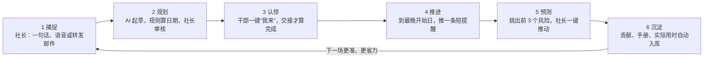
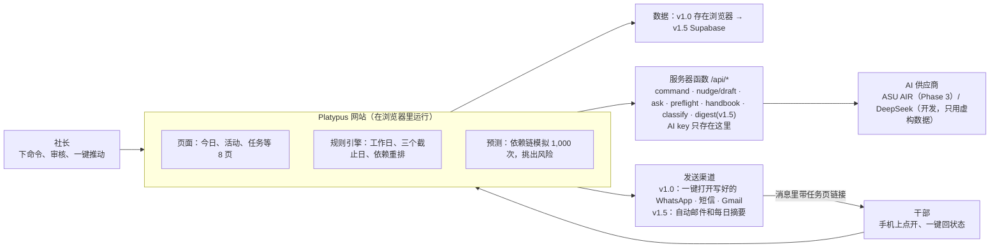

> **2026-10-26 Activity Workspace已批准实施：** A1/B1/C2、个人三列Board、活动短链、Funding并入活动、8/7/6周组织时间默认、全局AI及稳定ID。首页重点事项直接从个人任务排序，不另生成摘要。详见 [本轮唯一实施范围](organization/ACTIVITY_WORKSPACE_PLAN.md)。不含main合并/正式发布/正式多人账号。

> **2026-10-26 F1–F7（Juanxi 在审计方案后回复“执行”）：** 批准独立 Worktree 多 Agent 补保存恢复、增量复核、图与风险卡交互、性能诊断，并将服务器批准组织配置接通新版工作区。旧原型保留独立示例入口；不扩张完整 Board planner/真实账号/旧业务迁移，不合并 main 或正式发布。当前交接见 [实施记录](organization/F1_F7_IMPLEMENTATION.md)，以下更早记录保留为历史。

> **2026-10-26 v3（Juanxi 明确要求）：** 五章替代旧六步矩阵/Board setup。先部门再组织图；职责按岗位条目审阅、Check 重大风险 flashcard，可跳过；活动图内编辑与多人负责人、部门色；右侧上下文 AI 先提变更后批准。Review 显示实际输入并由服务端编译 JSON。无修改返回不跑 AI，小改动尽量保留后续手动数据。Prompt 隐藏于产品，只在开发聊天审核；为修复 JSON 错误允许少量真实冒烟。见 [v3 修改记录](organization/V3_CHANGELOG.md)。

> **2026-10-26 底层原则（Juanxi 明确要求）：数据记录、管理、治理与受控共享先于 AI。** 新版 Organization Setup 已建立操作/配置历史、原件、交互、AI 输入输出与决定的时间戳归档。当前以私有工作区保存，不自动跨组织共享；详见 [数据基础](organization/DATA_FOUNDATION.md)。默认 Muse 快速模型，GLM 仅主动深度检查；真实 AI 验收交给 Juanxi，停止额外额度消耗。

> **Organization Setup 增量（2026-10-25，Juanxi 已授权）：** 原型验收反馈后继续接入真实 AI 与线上保存；以 constitution 提取、分组多岗位职责矩阵、可编辑活动流程、后台 RACI 和组织 AI 指导文档为准。每步 AI 预填，社长审阅调整；最终增加 prompt 审核提醒。旧页面与数据保留，独立分支上线，不改 main。详见 [实现交接](organization/HANDOFF.md) 与 [Prompt 说明](organization/PROMPTS.md)。

> **2026-10-25 新方向（Juanxi 已确认）：** 当前增量工作为 AI-native Phase 1，Activity-centered、Organization Context driven。下文 v1.0/v1.1 为保留的历史基线；与本次提示冲突的导航、固定岗位与设置方式以新设计为准。先验收三个高保真画面，再决定正式接入。目标模型、复用与迁移边界见 [Phase 1 底层设计](phase1/ARCHITECTURE.md)，验收见 [交接](phase1/HANDOFF.md)。不改 main，不删除旧页。

# Platypus 产品计划 v1.0

2026-10-22 · Juanxi (Steve) Wu · 起草：Claude

> **状态：已批准（2026-10-22，Juanxi 批准第 16 节全部 10 个决定）。2026-10-23 按批准的《简化改版方案》更新第 6 节（v1.1 界面）。**
> **唯一正本：** GitHub 仓库 `juanxiwu2005/platypus-officer-hub` 的 `docs/PRODUCT_PLAN.md`。本地备份：Honors Thesis 文件夹 `05_Phase3_Prototype/Plan/Platypus_产品计划_v1.0.md`。审阅用的 Claude 文档（https://claude.ai/artifact/U9kHk73F9eYmPhJYbZBjES）停在批准时的版本，之后不再同步。
> **给接手的 AI：** 先读仓库根目录的 `AGENTS.md`，再看 `docs/PROGRESS.md` 了解做到哪了。题号（如 C2、E7、M3）指 Juanxi 对《社长深访提纲》的回答，原件只在他的本地文件夹里。

Platypus 从“活动提醒网站”升级为学生社团的团队型 AI 幕僚长：社长用一句话布置，Platypus 把它变成一张有唯一负责人、三个截止日和依赖链的流程图，提前预测哪一环会掉链子，并让社长一键把提醒发到干部常用的 WhatsApp、短信或邮件。和 v0.2 相比有三个根本变化：首页从文字清单改成“对话框 + 风险队列 + 活动流程图”；提醒从“写得完整”改成“短、先讲 Why、在对的时间推到对的渠道”；交接从卸任时补写改成平时自动积累。计划分四个版本：11/8 冻结 v1.0 用于 Phase 3；12 月 v1.5 在 SEO 真实试用，并支撑你自己的换届；2027 年春 v2 与 EOSS 做多社团试点；之后走向多校。文末有 10 个需要你批准的决定，批准后由 Claude Code 按第 13 节的工作包执行。

## 1. 定位：社团的团队型 AI 幕僚长

**一句话：** Platypus 是学生社团的团队型 AI 幕僚长（chief of staff）。它懂学校规则、记得社团历史、看得见每一环的进度，并在事情掉链子之前提醒对的人。

产品论点有三条：

1. **社团缺的不是工具，而是“有人一直盯着全局”。** 现在这个人是社长：你每周花 2–3 小时追进度，却往往在截止前 5–10 天才发现问题（A3、B4）。
2. **个人 AI 已经普及，团队型 AI 还是空白。** 问卷里只有 6% 的团队把 AI 助手列为社团的常用协作工具。这不是说学生不用 AI，而是说没有一个 AI 知道“谁在做什么”，也没有一个 AI 能汇总跨社团的经验（N3）。
3. **所以 Platypus 叠在现有工具之上，不替换它们。** 文件留在 Drive，宣传和会费留在 Sun Devil Central，聊天留在 WhatsApp。Platypus 只做一件现在没人做的事：盯住每一环、提前预警、一键推动（L2、L3、L6）。

| 需求 | 个人 ChatGPT | Notion / Airtable | 学生自建工具 | Platypus |
| --- | --- | --- | --- | --- |
| 知道本学期 ASU 规则并给出处 | 泛泛而谈，可能过时 | 只有自己存的 | 看作者 | 每条带出处和核实日期 |
| 知道谁在做什么 | 不知道 | 要人手动维护 | 部分 | 一句话布置、一键认领、自动记录 |
| 提前知道哪一环会晚 | 不会 | 不会 | 不会 | 依赖链加预测 |
| 推到干部真正会看的渠道 | 不会 | 邮件通知 | 不一定 | WhatsApp、短信、邮件，一键发出 |
| 跨社团的经验 | 没有 | 没有 | 没有 | 匿名回报汇总（v2） |
| 换届不清零 | 没有 | 取决于有没有人读文档 | 作者毕业就停 | 平时自动积累，到点推送 |

**名字：** 问卷里 Lasso 得票最高（28%），但 lasso 有“套住”的意思，和“支持而不是控制”的定位冲突；Platypus 可爱、好记。论文如实报告得票，并写明这个理由。

## 2. 访谈结论：8 个假设的判定

8 个假设里 5 个成立、2 个被扩展、1 个被修正。括号里是深访提纲的题号。

| # | 假设 | 判定 | 你的回答 | 产品后果 |
| --- | --- | --- | --- | --- |
| 1 | “管控”是看得见，不是管得住 | 修正 | 二选一时你选“一键让落后的人动起来”，前提是系统先算出哪一环落后（C2） | 首页是“风险队列 + 一键提醒”。看得见是输入，推得动是输出 |
| 2 | 拖延主要是“排在后面”和“等别人” | 成立并细化 | 常规任务多是忘了，创新任务是不会，还有考试周和上游卡住（E1） | 按原因分四种干预：及时提醒、教程与帮助、避开忙碌周、依赖链预警 |
| 3 | 干部不会主动打开网站 | 成立 | 首选 WhatsApp，其次 Drive 里的表，最后才是邮件（E7） | 提醒推到 WhatsApp、短信、邮件；干部端只是一张从消息点开的手机页 |
| 4 | 社长只愿输入一句话 | 成立 | 入口散在私聊、群聊、表格、会议和转发邮件里；手动维护让你放弃了任务表（D1–D2） | 对话框是最显眼的入口，支持打字和语音（v1.1 起放在每一页的右栏 Ask） |
| 5 | 用“被看见的贡献”换状态更新 | 成立 | 积分制失败是因为人工录入太麻烦；自动记录、每月报告会让激励“轻松很多”（H1–H2） | 贡献记录自动生成；公开“本周之星” |
| 6 | 交接靠平时顺手记录 | 成立并扩展 | Why 最难留，strategy document“基本上没人读”；人脉绑定组织，靠活动频率维系（I1–I4） | Why 跟着步骤出现，不写进长文档；联系人和活动日历联动 |
| 7 | AI 的信任来自可核查 | 成立 | “本周没有待办”很难相信，除非解释来源；错了可以继续用，但要有反馈渠道（J1–J3） | 每个结论带来源；发提醒前核对最新状态；一键报错 |
| 8 | 护城河是跨社团流程经验 | 扩展 | 你列了四条：ASU 规则整合、跨社团数据、与 EOSS 合作、预测预警（N4） | 四条都进路线图；跨社团数据从 v2 开始积累 |

三条改变设计最多的新发现：

1. **Platypus 的心脏是“预测 + 一键推动”。** 你要的不是更漂亮的进度表，而是在来得及的时候知道该推谁，并且推一下不用花力气。
2. **干部更新状态的成本必须接近零。** 你的快问快答是“0.1 分钟”。状态只能从消息里一键回复，或由系统推断，绝不能要求他们打开网站填表。
3. **Platypus 必须主动找社长，而且只在重要时找。** 你不会为一个固定的日历提醒打开它，只在“紧急又重要”时才看（K7）。所以每天给社长的推送只报风险，没有风险就不发。

## 3. 核心闭环

Platypus 的每个功能都挂在一个六步闭环上；不服务这个闭环的功能，v1 不做。

图：核心闭环。社长只在 1、2、5 三步出手（说一句话、审核变更单、一键推动）。

粗框是社长要出手的三步，其余由 AI、规则引擎和干部完成。

1. **捕捉：** 社长用一句话、语音、粘贴的聊天记录或转发的邮件告诉 Platypus 一件事。
2. **规划：** AI 判断它是活动、干部任务还是成员事务，按流程模板拆成节点；规则引擎算出三个截止日；社长审核这张“变更单”后才生效。
3. **认领：** 每个节点发给唯一负责人，对方一键认领后，任务才算真正交出去。
4. **推进：** 到“最晚开始日”推一条短提醒；干部在消息里一键回状态；一直沉默就按协议升级。
5. **预测：** 每天重算依赖链，算出每场活动按时完成的把握，把最危险的 3 件事放进社长的风险队列。
6. **沉淀：** 完成的节点自动变成贡献记录、岗位手册条目和“实际用时”，下一场活动和下一任干部直接用。

## 4. 八个核心机制

这八个机制把你在访谈里描述的管理习惯变成产品规则，是 Platypus 和普通任务工具最大的不同。

| 日期（示例：USG 餐饮申请，活动 11/19） | 名称 | 触发的动作 |
| --- | --- | --- |
| 周三 10/28 | 最晚开始日 | 推送短提醒，按个人偏好的渠道和时间 |
| 周五 10/30 | 社团截止日 | 逾期：当天通知社长；私下处理，按沉默协议升级 |
| 周三 11/4 | 官方截止日（学校） | 进入 Plan B：改期、换经费来源或缩小规模 |

最晚开始日 → 社团截止日 = 预计用时 1 天 + 个人缓冲 1 天；社团截止日 → 官方截止日 = 社团缓冲 3 个工作日。日期为示意。

干部收到的是“最晚开始日”，社长只在“社团截止日”过了才被叫到；学校的官方截止日留给 Plan B。

| 机制 | 怎么运作 | 依据 | 版本 |
| --- | --- | --- | --- |
| 1. 三个截止日 | 每个节点显示官方截止日（学校）、社团截止日（官方减去社团缓冲，默认 3 个工作日）、最晚开始日（社团截止日减去预计用时、个人缓冲和忙碌周）。“逾期”指过了社团截止日，当天通知社长；过了官方截止日就进入 Plan B | 快问 7；E2 你算的“10/26 最晚开始” | v1.0 |
| 2. 认领握手 | 任务发出后，对方点“我来”才算交接完成；48 小时没认领，回到社长的风险队列 | D2：写下任务反而成了你自己的任务 | v1.0 |
| 3. 一键状态与“带草稿延期” | 消息里四个按钮：完成、在等别人（选等谁）、需要帮助、申请延期。申请延期必须附上当前草稿，社长一键批准或拒绝 | C3 你的规则：拿不出草稿就不能延期；快问 5：更新状态约 0 分钟 | v1.0 |
| 4. 风险队列与一键提醒 | 首页最多显示 3 件最危险的事，每件写清原因；旁边一个按钮，用对方偏好的渠道发一条写好的提醒 | C2：一键让人动起来 | v1.0 |
| 5. 沉默协议 | 沿用 SEO 的 Ghost Owner Protocol：第 3、5 天自动轻提醒；第 7 天提示社长私聊并设 24 小时期限；第 8 天建议临时接手人；第 10 天生成新时间线和复盘任务。全程私下进行，天数可改 | SEO Strategy 4.4；C4 私聊而不是公开批评 | v1.0 演示 / v1.5 真实计时 |
| 6. RACI 自动路由 | 每个节点有一个 R（负责）、一个 A（批准）、若干 C（咨询）和 I（知会）。节点完成或延误时，系统按 RACI 决定通知谁：下游收到“可以开始了”或“顺延提示”，批准人收到审批请求，社长只在有风险时被打扰 | F5：教授推荐的 RACI | v1.0 |
| 7. 贡献记录 | 完成的节点按难度档（轻、中、重）和是否按时自动记分；每月生成贡献报告，社长批准后可转给指导老师；首页显示“本周之星”和完成榜；干部自己提出并完成的提案额外加分 | H1–H2、H5、H6 | v1.0 显示 / v1.5 导出报告 |
| 8. Plan B 库 | 每类活动预置 2–3 个降级方案（无餐饮版、会费出资版、缩小规模版）；经费到“决定日”还没批，系统自动把选项摆给社长 | F6；SEO 案例：Marc Lore 活动在两周前才启动 Plan B | v1.0 |

忙碌周和个人缓冲都来自首次设置（第 7 节），并随历史记录调整（第 9 节）。

## 5. 提醒的写法

> **2026-11-17 增量（Juanxi 已批准实施）：** 所有实际活动节点与负责人邮件入口统一为简洁任务详情及Edit右侧面板；工作成果采用一个Details文本框和多附件，不按房间/SAP等节点另建字段。草稿独立，真正提交与完成原子保存；财务节点仍由Event Budget管理完成。任务可配置多个外部办理链接，Settings工作流模板明确不改。见[统一详情与提交交付](feedback-fix/TASK_DETAILS_UNIVERSAL_HANDOFF.md)。
> **同日追加（附件与自动草稿）：** 最多3个附件、2MB/个、当前附件总计5MB；Details与选择/移除附件自动保存，不再需要Save draft，切换任务后继续原草稿。原始字节与草稿用浏览器IndexedDB事务保存，正式提交/完成仍另行确认；完整导出包含草稿与文件字节。当前仍限同一浏览器，不等于服务器上传或跨设备同步。
> **同日追加（延期与完成退回）：** Need more time仅填写Requested club deadline和可选Message，不再要求Current draft link；保存申请后自动通知当前审批人及社长/副社长，点通知直达任务内审批，批准前不改截止日或进展。普通任务完成后提供Undo mark done，也可随时从Task status改回To do、Working on it、Stuck或Waiting on；正文/附件和提交历史保留，清除完成标记与积分，财务节点仍由Event Budget管理。当前为同浏览器站内通知，不新增外部投递。

> **2026-11-16 增量（Juanxi 已批准至阶段三，技术交付待验收）：** 提醒全文由规则生成，主题“活动 · 任务”，一个重点Task due，开始日内置为触发说明；读取真实要求和意义，加入协作与感谢，邮件只有一个可重复任务入口。Details按任务、办理、提醒计划三段展示；单条、批量、自动演示都保存完整已校验邮件后才计为记录，不再派生虚拟已发送。Waiting on为明确现任对象生成独立跟进，对方只能回应协助，原任务负责人不变。新组织默认v2，旧存档显式升级且保留设置/历史；自动仅在应用打开时运行。见 [实施方案](feedback-fix/REMINDER_IMPLEMENTATION_PLAN.md) 与 [阶段三交付](feedback-fix/REMINDER_STAGE3_HANDOFF.md)。真实后台、跨设备身份、定时投递和外部联系人路由仍在后续；以下旧模板保留为历史，不代表新界面。

提醒从“写得完整”改为“分点短行、先讲 Why、只给一个动作”。问卷已经证明详细提醒更清楚（78%），却没有明显让人更早开始（55%）；你的答案指出缺的是后果和意义，不是步骤（E2–E3、E8、J1）。

| 规则 | 内容 |
| --- | --- |
| 长度 | 正文约 100 个英文单词以内，用分点短行，不写成一整段。主题行就写动作、用时和截止日；更长的材料放进点开的任务页 |
| 结构 | 固定分段：Why now（后果和谁在等，用依赖链里的真实日期）→ What → When（建议时段和截止日）→ How（最多 3 步）→ Why it matters（意义），最后是四个状态按钮。顺序沿用你的“三明治”和黄金圈 |
| 语气 | 用 “we”，支持而不是命令；不评价对方的能力和用时 |
| 禁用说法 | “Is it done yet?”、“ASAP”、“This should only take an hour”、“Just use AI”、全大写的 URGENT、公开点名。AI 生成后由程序再检查一遍，命中就重写 |
| 时机 | 按个人偏好在早上或晚上发；复杂或用时波动大的任务提前；忙碌周提前发或避开；晚 10 点到早 8 点不发 |
| 次数 | 同一任务最多 3 次；一旦标为完成或对方回复，立刻停止。重复提醒已完成的事，是你在 J1 特别点名的问题 |
| 新鲜度 | 状态超过 3 天没更新时，第一句改为“如果已经完成，点这里告诉我”：先确认，不假设对方没做 |
| 渠道 | 按个人偏好排序，默认 WhatsApp → 短信 → 邮件（E7、快问 11） |

示例（分点结构，正文约 100 个单词，发给财务）：

> **Subject:** Start today: USG food request for Networking Night (\~30 min, due Fri Oct 30)
>
> Hi Maya,
>
> **Why now:** Everything else for Networking Night is waiting on this step. In by Fri Oct 30, approval lands before we confirm the caterer; any later, we'd have to drop the dinner.
>
> **What:** Submit the USG food request.
>
> **When:** Suggested slot Wed Oct 28, 7:00–7:30 pm (on your calendar). Club deadline Fri Oct 30; official deadline Wed Nov 4.
>
> **How (about 30 min):**
>
> 1. Open the USG funding form \[link\]
> 2. Paste the ready-made answers \[copy\]
> 3. Attach the caterer quote and the flyer, then submit
>
> **Why it matters:** This is what makes the night work for our members. Thanks for carrying it.
>
> &#91;Done\] \[Waiting on…\] \[Need help\] \[Need more time\]

这是按你的意见改成的分点版本。M2（改写提醒）你说后续再讨论，我们在工作包 WP2 的评审里用你自己的版本定稿。

## 6. 页面与信息架构（v1.1，2026-10-23 更新）

> 本节按《Platypus 简化改版方案》（https://claude.ai/artifact/QhCthf71crEC62bBua5zJD，2026-10-23 批准，8 个决定见 `docs/PROGRESS.md` 决定记录）重写。界面规则的正本是 `AGENTS.md` 第 7 节。

**一句话：** 用颜色、形状和位置说话，文字只在鼠标停下或点开时出现。借鉴 monday.com（一种容器、颜色即状态、原地编辑、AI 侧栏）和 Trainual（内容切小块、流程图少写字）。

**三栏布局：** 左边导航（8 页 + 设置、帮助）；中间内容；右栏有两个标签——**Ask**（全站唯一的 AI 入口）和 **Details**（点任何东西打开的详情）。手机上右栏是全屏面板，从右下角按钮打开。演示控制（日期、模拟时钟、重放设置、重置）收进顶栏的 “Demo” 小标，私下更新收进铃铛。

**5 个通用组件：** 状态色块（6 色：Not claimed 灰、To do 蓝、Working on it 橙、Waiting 紫、Stuck 红、Done 绿）、进度链（像查快递）、表格、悬停卡、右栏详情。**三级交互：** 看颜色 → 停在上面看悬停卡（最多 3 行）→ 点开右栏。

| 页面 | 回答的问题（导航悬停提示） | 主要视觉 |
| --- | --- | --- |
| Today | 今天该推谁？ | 风险前三行（圆点颜色 + Remind 按钮）；每场活动一条阶段进度链；学期目标圆环；本周之星 |
| Events | 这场活动走到哪、下一步谁来？ | **单主线流程图**：主线是到活动当天最长的依赖链，平行工作分叉再汇回；节点只有圆点、短名、负责人；悬停看截止日和原因，点开改负责人和社团截止日。另有列表视图 |
| Tasks | 我该做什么？ | 表格（按活动分组，远期组折叠，负责人和截止日原地改）；看板（拖拽改状态和顺序，状态名称颜色、标签、卡片字段可自定义）；Timeline |
| Team | 谁超载、谁该被表扬、什么时候能开会？ | 工作量档位条；贡献表；一周空闲热力图 + 会议时段 |
| Funding | 每笔钱走到哪一步？ | 每场活动一行的物流链表（6 站），顶部三个合计；点一行在右栏填金额、做提交前检查、看 Plan B |
| Handoff | 换届怎样不清零？ | 换届季进度链；每个岗位一张接力卡（卸任人 → 新任人、进度环）；点开是分步手册 |
| Partners | 哪些关系该联系了？ | 可搜索、可筛选的表格，距上次联系天数带颜色，可直接新增 |
| Rules | 学校怎么规定？ | 一行一条短句 + 时限标签 + 直达官网按钮 + 问 AI 按钮；全文和核实日期在悬停卡 |
| Settings | Platypus 怎样为这个社团工作？ | 分 5 块（Club、Roles、Links & files、My preferences、Admin），改了就自动保存，可撤销 |

**Ask 面板的 6 种回复卡片：** 文字、补信息表单（例如策划活动时让你填日期、人数、地点、餐饮、经费）、任务清单、变更单（逐条批准）、提醒草稿、规则答案（带出处）。明确的请求由应用自己处理，不用等 AI；其余交给 `/api/chat`。服务器和浏览器都会过滤卡片，AI 写的日期一律丢弃。

**字数上限（主区可见文字）：** Today 160、Events 180、Rules 170、Tasks 130、Team 130、Settings 每块 125。2026-10-23 实测：105 / 95 / 134 / 111 / 108 / 89，比改版前少 60–75%。

设计原则（沿用 v1.0）：

- **图优先于字。** 能用节点、条形或颜色表达的，不写段落；解释和免责声明放在帮助页或悬停卡里。
- **干部端手机优先。** 从消息点开就是自己的任务页，不需要密码（带签名的一次性链接）。
- **每个数字都能点开看来源。**
- **不显示监控类数据。** 没有登录记录和在线时长，只看成果是否按时（C6）。
- **进度对干部公开，升级只在私下。** 发提醒的权限只给社长、副社长和管理员（C5–C7）。

## 7. 首次设置：社长 5 分钟，干部 2 分钟

目标是 5 分钟内看到第一张流程图（K2、快问 6）。不问与社团无关的问题；干部的信息由他们自己填。

社长的五步：

1. **社团（30 秒）：** 名称、学校（自动套用 ASU Tempe 规则包和校历）、一句话使命（可跳过）。
2. **学期目标（60 秒）：** 从建议里选 2–3 个并填数字，例如每周一场活动、30 位忠实成员、$1,000 外部收入（来自 SEO Team Charter）。
3. **岗位（60 秒）：** 从模板选岗位，名称可改，每个岗位映射到一个通用职能；也可以从表格粘贴干部名单。
4. **邀请干部（30 秒）：** 生成一个邀请链接，发到干部群里。
5. **第一件事（60 秒）：** 用一句话说出下一场活动，Platypus 立刻画出流程图。第一次使用就看到价值。
6. 这里要多加一个设置步骤，应该在首次设置的时候就配置好：
   1. 连接系统（必须配置的连接器）：

   (a) Google Calendar 系统

   (b) Gmail 或 WhatsApp
   1. 社团介绍与规划说明：

   跟 AI 解释一下社团平时是怎么规划活动的（不一定只用一句话），讲一下具体的职责分工，或者在之前那一步怎么进行调整。这样 AI 就可以自动匹配我们的通用模板。
   1. 上传社团现有的规划文件：
   - 如果全部放在 Google Drive 里，连接器会自动访问。
   - 如果放在其他储存系统，希望社长能先把 schedule 系统的文件下载下来，再上传到我们首次测试的平台里。

可选一步：粘贴社团 Drive 文件夹链接。页面会写明原因：让每个节点直接带上材料，交接手册也能链到原文件（K2）。

干部的五个问题（在手机上完成）：确认姓名和岗位；提醒渠道和号码；早上还是晚上收提醒；本学期的忙碌周（考试、出行）；你入团时一定会问的三件事——职业目标、兴趣、对这个岗位的期望（G4）。

| 设置数据 | 之后影响什么 |
| --- | --- |
| 渠道与时间偏好 | 提醒发到哪里、几点发 |
| 忙碌周 | 最晚开始日自动提前；分配时避开考试周（B2） |
| 职业目标与兴趣 | AI 建议负责人时优先匹配；贡献报告突出与目标相关的工作 |
| 岗位映射 | 流程模板自动把节点分给对应岗位；跨社团经验可以对齐 |
| 学期目标 | 今日页的进度条；新活动挂到对应目标下 |
| Drive 链接 | 节点材料和交接手册的链接 |

演示版不会每次弹出设置，只在顶栏放一个“重新体验设置”按钮（你在 M4 的要求）。v1.5 再加“从 SEO ERP 表格导入”，让 SEO 试用不用重新录入。

## 8. AI 的角色与护栏

AI 是起草员和观察员，不是决策者：它起草变更单、提醒、答案和手册，日期由规则引擎计算，生效由人批准。

| AI 任务 | 输入 | 输出 | 谁批准 |
| --- | --- | --- | --- |
| 理解一句话 | 社长的句子、语音转文字、粘贴的聊天或邮件 | 一张变更单：要新建或修改的活动、节点和负责人，并注明是干部任务还是成员事务 | 社长逐条通过或修改 |
| 起草提醒 | 任务、依赖链、收件人偏好 | 分点、正文约 100 词以内的提醒，已通过禁用说法检查 | 默认社长；v1.5 起可选自动 |
| 回答规则问题 | 问题和规则库 | 1–3 句答案，每句带规则编号；找不到就拒答，并给出该问的办公室 | 不需要 |
| 经费提交前检查 | 申请包里有哪些材料 | 缺什么、依据哪条规则 | 财务负责人 |
| 理解干部回复 | 一句回复 | 完成、在等、要帮助、其他；把握不够就交给社长 | 自动，低把握转人 |
| 交接访谈与手册 | 任务记录和访谈回答 | 岗位手册草稿 | 卸任干部确认，社长批准 |
| 外部会议邮件（v1.5） | 内部共同空闲时间 | 附 3 个时间的邮件草稿 | 社长 |

AI 绝不做的五件事（前三条是你定的，J1）：

1. 编造事实。找不到依据就说“规则库里没有”。
2. 未经同意联系社团以外的任何人。
3. 用不友善的语气提醒成员。
4. 计算或修改任何日期。
5. 读取成员名单或学生个人信息。

**两种发送模式（快问 8：给用户选）：** “审核后发送”是默认，AI 起草，社长或副社长点一下发出。“自动发送”从 v1.5 开始提供，只限社团内部提醒、只走邮件，由社长在设置里开启；对外联系永远要人批准。v1.0 的“发送”是一键打开已写好的 WhatsApp、短信或 Gmail，由人按发送。

**准确性与反馈：**

- 每个答案、每句“本周没有待办”都列出查了哪些来源（J2）。
- 每条 AI 输出旁有“这不对”按钮，进入管理员队列（J3）。
- 固定测试集：30–50 道规则题（含故意超出范围的题）、20 句命令、20 条提醒的语气检查。每次换模型前后各跑一遍。
- 模型：Phase 3 用 ASU AIR（数据留在 ASU）；开发阶段用现在已接通的 DeepSeek，只处理虚构数据。切换只改 Netlify 的环境变量。
- 读取邮箱和 Drive：只考虑社长自己的账号、只读、v2 再做。接入每位成员邮箱的顾虑（容量、调用量、安全、开源模型接入复杂度）你已经列出，v1 不碰（J5）。
- “只用规则”模式：你认为必要性不大（J6）。保留为设置里的一个开关，不再为它单独设计页面。

## 9. 预测与风险

Platypus 用模拟而不是猜测来回答“这场活动会不会出事”：把依赖链随机跑 1,000 次，看有多少次能在社团截止日前完成。这就是你在 E2 里设想的“33% 的概率导致后续错过截止日”，而且每个数字都能说清楚假设。

**怎么算：**

1. **用时范围：** 每个节点按难度档给一个范围（轻 1–2 天、中 3–5 天、重 1–2 周，可调）；涉及学校审批的节点按官方时限加经验余量。
2. **个人缓冲：** 每位干部起点相同，之后按他自己过去按时完成的比例慢慢调整；忙碌周再加一段。
3. **模拟：** 每天把整条链抽样 1,000 次，得到每个关键节点按时完成的比例。
4. **显示：** 默认只显示颜色和原因——绿色（至少 80% 的模拟按时）、黄色（50–80%）、红色（低于 50%），旁边写最大的两个原因，例如“上游场地确认还在等”、“负责人下周有考试”。点开才显示百分比和假设。

**冷启动：** 没有历史数据之前，用官方时限、你给的“经费至少提前 6–8 周”（F3）和 SEO 活动模板的 T-90 / T-60 / T-30 / T-14 节奏。

**个人缓冲的伦理边界：** 它在推断一个人的习惯，所以必须透明、可控。

- 干部本人能看到自己的缓冲和理由。
- 不公开，不进排行榜；只用于排期，不用于评价。
- 只用本社团的任务记录；换届时清零，或由本人决定是否保留。
- 本人可以关闭，改用默认值。
- 叫“个人缓冲”，不叫“拖延分”。

这也是论文里可以写的设计贡献：用透明的预测建立恰当的信任（Lee & See，2004），用自主支持的措辞保护动机（Deci 等，1994）。

**跨社团信号（你的“魔法棒”，M5）：** 每次审批后，干部一键回报“这次批了几周”（68% 愿意回答）。同一流程满 5 条才显示，例如“最近 USG 审批中位数 3 周（12 个社团回报）”。另加一个规则变化检测：每周检查规则来源页面有没有更新，变了就提醒管理员核实。前者从 v2 开始，后者 v1.5 就能做。

## 10. 指标体系

**北极星指标：关键节点按时率**——每周到期的关键路径节点中，在社团截止日前完成的比例。它直接对应你说的“核心还是不错过 deadline”（N7）；只算关键路径，靠刷小任务刷不上去；每个社团都能算，跨社团也可比较。

| 类型 | 指标 | 定义 | 为什么要它 |
| --- | --- | --- | --- |
| 驱动 | 按时开工率 | 在最晚开始日或之前被认领并开始的节点比例 | 直接衡量“更早开始”，即问卷里最弱的 55% |
| 驱动 | 提醒到行动的时间 | 提醒发出到对方点任何状态按钮的中位小时数 | 你提的“任务流转效率” |
| 驱动 | 沉默节点数 | 7 天以上没有任何更新的节点 | Ghost Owner 的早期信号 |
| 驱动 | 经费一次通过率 | 提交后没有被退回补材料的申请比例 | F1：最大的风险是提交时不合规 |
| 驱动 | 社长每周行政时间 | 每周日一键自报（0–1、2–3、4–6、7 小时以上） | 你的“每周行政时长” |
| 驱动 | 每周活跃干部比例 | 一周内至少回过一次状态的干部比例 | 采用的真实信号 |
| 护栏 | 每人每周收到的提醒数 | 上限 6 条 | 超过就是在“轰炸” |
| 护栏 | 静音或退出率 | 关掉提醒的干部比例 | 提醒是否让人反感 |
| 护栏 | 压力感 | 每月一键评分“提醒让我有压力” | 守住“支持而不是控制” |
| 护栏 | AI 错误报告数 | “这不对”按钮的次数和类型 | 信任的底线 |
| Phase 3 | 任务成功率与用时 | T1–T6 逐项记录 | 实验室里可测，不依赖长期使用 |
| Phase 3 | SUS、NASA-TLX 原始版 | 标准量表；SUS 68 分常被当作平均线 | 可用性和负荷 |
| Phase 3 | 信任校准 | 参与者有没有点开来源核对 | 是否“恰当地”信任 AI |

Phase 3 只能测实验室里的指标；北极星和驱动指标从 v1.5 的 SEO 真实试用开始积累，写进论文的“未来研究”。

## 11. 技术方案

> **v1.2 补充（2026-10-23，Juanxi 批准）：AI 的数据权限。** 读：AI 能看到当前查看者在页面上能看到的全部数据（别人的个人缓冲和私信除外），以及服务器上的共享池（v1.0 为虚构演示，只读；v2 换成各社团自愿共享的真实数据）。写：只能改本社团的数据，权限和查看者本人一样；改状态、改名、标签、难度、记录联系这类小改动立即生效并可撤销，换负责人、加任务、改活动、改经费、加伙伴等仍要社长或副社长确认。共享池任何人和 AI 都不能通过 AI 修改。日期仍只由规则引擎计算，AI 只能复述已有日期。

继续用方案 C 的骨架（Netlify 静态网站 + 服务器函数 + 可替换的 AI 供应商），但前端从单个 HTML 文件升级为正式的应用工程。仓库里已经有 5 个服务器接口（AI 部分已接通 DeepSeek），全部保留。

图：系统架构。AI key 只在服务器上，日期只由规则引擎算。

规则引擎和预测都在浏览器里运行，所以演示不依赖网络；AI 只通过服务器函数调用，换供应商只改环境变量。

| 层 | v1.0（11/8） | v1.5（12 月） | 理由 |
| --- | --- | --- | --- |
| 前端 | React + TypeScript + Vite；React Flow 画流程图；手机自适应 | 同左 | 现在的单文件已有约 13.7 万字符，流程图、拖动编辑和 8 个页面在单文件里难以维护 |
| 托管 | Netlify，推送即部署。开发在 v1 分支的预览网址进行，11/8 再合并到 main | 同左 | 开发期间正式网址保持稳定，委员会随时可看 |
| 数据 | 只存在浏览器里：虚构演示组织，可一键重置，每位 Phase 3 参与者一份 | Supabase（Postgres 免费层）+ 邮件一次性链接登录 | Phase 3 不在服务器存任何参与者数据，IRB 最简单；真实试用才需要多人同步 |
| AI | 现有适配器；开发用 DeepSeek，Phase 3 用 ASU AIR | 同左 | 已经接通，换供应商只改环境变量 |
| 发送 | 一键打开写好的 WhatsApp、短信、Gmail，由人按发送；日历链接 | 邮件自动发送（smtp.asu.edu 或免费发信服务）；每日风险摘要 | WhatsApp 商业接口需要企业认证和模板审批，放到 v2 |
| 定时 | 演示用“模拟时钟”，可快进几天看沉默协议和预测的变化 | Netlify 定时函数：每天早上算风险、发摘要 | Phase 3 是 60 分钟的会话，需要快进 |
| 测试 | 规则引擎单元测试、Playwright 端到端测试、AI 测试集 | 加上线上错误监控 | 你不写代码，测试就是你的质量保障 |

数据模型（v1.0 和 v1.5 共用，只有存放位置不同）：

| 对象 | 主要字段 |
| --- | --- |
| Org 社团 | 名称、学校、使命、学期目标、设置（社团缓冲天数、沉默协议天数、发送模式） |
| Role 岗位 | 显示名称、通用职能、现任者 |
| Person 干部 | 姓名、岗位、渠道与号码、提醒时间偏好、忙碌周、职业目标与兴趣、个人缓冲 |
| Event 活动 | 名称、日期、类型、人数、场地、餐饮、经费来源、关联目标、流程模板 |
| Node 节点（任务） | 标题、所属活动或事务、R/A/C/I、依赖、难度档、三个截止日、规则编号、状态、认领时间、等待对象、草稿链接、Why |
| Playbook 流程模板 | 节点模板、默认提前量（T-90/60/30/14）、默认 RACI、Plan B 选项 |
| Nudge 提醒 | 节点、渠道、文本、发送人、时间、回应 |
| Contribution 贡献 | 人、节点、分数、是否按时 |
| Contact 联系人 | 姓名、组织、关系、上次联系、建议频率、负责岗位、关联活动 |
| Funding 经费 | 活动、阶段、金额、提交前检查结果、用款截止日 |
| Rule 规则 | 编号、类别、内容、时限、出处、核实日期 |
| Handoff 换届季 | 时间窗、岗位、访谈、手册版本 |
| ChangeSet 变更单 | AI 提议的操作列表、状态（待审、已应用、已拒绝） |

AI 接口：

| 接口 | 状态 | 作用 |
| --- | --- | --- |
| `/api/health`、`/api/replies/classify` | 已有，保留 | 检查 AI 是否可用；理解干部回复 |
| `/api/ask` | 已有，升级 | 加上规则类别，并返回“查了哪些来源” |
| `/api/parse-brief`、`/api/plan/draft` | 已有，并入 `/api/command` | 保留为内部步骤 |
| `/api/command` | 新 | 一句话 → 变更单。只允许白名单里的操作（新建活动、加节点、指定负责人、设难度档、连依赖、提议提醒、回答问题）；输出中出现日期字段一律丢弃 |
| `/api/nudge/draft` | 新 | 提醒草稿，附禁用说法检查 |
| `/api/preflight` | 新 | 经费申请提交前检查，每条缺项带规则编号 |
| `/api/handbook/draft` | 新 | 从任务记录和卸任访谈生成岗位手册草稿 |
| `/api/digest` | v1.5 | 每日风险摘要：没有风险就不发 |

## 12. 版本路线图

四个版本各有一个明确的用户和闸门：论文版给 Phase 3 参与者，SEO 真实版给你自己的团队和换届，多社团版给 EOSS 试点，多校版给学校采购。

闸门（进入下一阶段的条件）：

1. v1.0 → v1.1：11/8 定版，T1–T6 在正式网址上走通。
2. v1.1 → Phase 3：IRB 获批，AI 测试集答对率 ≥ 90%。
3. v1.5 → v2：SEO 试用中关键节点按时率上升，每周活跃干部 ≥ 60%。
4. v2 → v3：EOSS 试点社团留下来继续用。

每个闸门都有可以检查的条件；过不了就停在当前阶段修，而不是继续加功能。

| 版本 | 时间 | 给谁用 | 重点 |
| --- | --- | --- | --- |
| v1.0 论文版 | 10/23–11/8 | Phase 3 参与者、委员会 | 完整闭环、全部八个机制、虚构演示社团、数据只在浏览器 |
| v1.1 | 11/9–11/15 | 一位不参与研究的同学试跑 | 修问题、切换 ASU AIR、AI 测试集过线 |
| Phase 3 | 11/16–12/4 | 4–6 位参与者 | 评估，代码冻结，只修阻塞性问题 |
| v1.5 SEO 真实版 | 12 月 | SEO 干部、你的换届 | 数据存储与登录、自动邮件和每日摘要、从 SEO ERP 导入、规则变化检测、贡献报告导出。SEO 试用只算开发测试，不进论文数据 |
| v2 多社团版 | 2027 年春 | EOSS 合作的 5–10 个社团 | 跨社团匿名回报、WhatsApp 商业接口、Google 日历忙闲、会议录音变任务、用真实数据校准预测 |
| v3 多校版 | 2027–28 | 其他学校 | 每校一个规则包（AI 抓取加学校合作）、学校付费、团队 AI 与个人 AI 协作 |

你在 M3 的取舍表落到各版本：

| 模块 | 你的判断 | v1.0 | 之后 |
| --- | --- | --- | --- |
| 任务、唯一负责人与提醒 | 必须 | 完整 | v1.5 自动邮件；v2 WhatsApp 接口 |
| 活动倒推时间线 | 必须 | 单主线流程图（v1.1；时间轴视图在 Tasks 的 Timeline） | v2 用跨社团用时校准 |
| AI 一句话拆解 | 必须 | 打字和浏览器语音输入 | v1.5 粘贴聊天、转发邮件 |
| 经费申请状态追踪 | 必须 | 阶段条、提交前检查、用款进度 | v2 跨社团审批用时 |
| 合作伙伴与联系人 | 必须 | 联系人和联系间隔提醒 | v1.5 前任引荐邮件 |
| 宣传排期 | 必须 | 作为流程模板里的宣传节点，各渠道提前量取自 SEO 的 Marketing 表 | — |
| 会议时间协调 | 必须 | 干部在设置里填空闲时段，系统找共同时间 | v1.5 外部会议邮件；v2 Google 日历忙闲 |
| 文件搜索与整理 | 必须 | 节点和岗位挂 Drive 链接 | v2 Drive 只读搜索 |
| 岗位手册与交接 | 必须 | 完整 | v1.5 用于你的真实换届 |
| AI 政策问答 | 必须 | 完整 | v1.5 规则变化检测 |
| 跨社团经验库 | 必须 | 框架和明确标注“示例”的内容 | v2 真实匿名回报 |
| 工作量看板 | 更好 | 档位条 | — |
| 贡献记录与激励 | 更好 | 榜单和本周之星 | v1.5 月度报告导出 |
| 预算总账 | 更好 | 只做用款进度 | — |
| 成员名单与出勤 | 更好 | 不做 | v2，且不重复 Sun Devil Central |
| 会议录音 → 任务 | 更好 | 不做 | v2 |
| 库存 | 不要碰 | 不做 | 不做 |

v1.0 的范围很大。如果进度落后，按这个顺序砍：合作伙伴页 → 会议时间查找 → 甘特图切换 → 语音输入。闭环本身（第 3 节）和 Phase 3 要用到的页面不砍。

## 13. Claude Code 执行计划

v1.0 分 7 个工作包，每个 2–3 天，都有可以检查的验收标准。每个工作包结束时，我发一个预览网址和一段 1 分钟能看完的变化说明；你只需要回“可以”或“改哪里”。

| 工作包 | 日期 | 交付物 | 验收标准 | 你要做的事 |
| --- | --- | --- | --- | --- |
| WP0 地基 | 10/23–10/24 | v1 分支；React + TypeScript + Vite 工程；沿用现在的配色和字体；本地演示数据与一键重置；8 个页面的导航和帮助页；本计划存入仓库 docs/；自动测试和预览网址 | 预览网址能打开；每次推送自动构建并跑测试；正式网址不受影响 | 10/23 RTO 咨询后，告诉我 AIR 的 key 和可用模型 |
| WP1 引擎与流程图 | 10/24–10/27 | 规则引擎移植到 TypeScript（工作日、ASU 假期、三个截止日、依赖）；流程模板（SEO 的 OA101 立项、OA102 执行、OA201 经费，加 T-90/60/30/14 清单和 R01–R16）；活动页泳道流程图、侧栏编辑、甘特图切换 | 单元测试覆盖示例活动的全部日期；改一个节点的日期，下游自动重排，违反规则的地方标红 | 10/27 看一次预览，确认流程图的样子 |
| WP2 今日页与提醒 | 10/27–10/30 | 对话框和 `/api/command` 变更单审核；风险队列和一键提醒（WhatsApp、短信、Gmail）加 `/api/nudge/draft`；活动条；学期目标；本周之星 | 20 句测试命令里至少 17 句生成正确的变更单；提醒全部通过禁用说法检查且正文不超过 100 词 | 用你自己的话改写一条提醒（M2），作为范例 |
| WP3 任务与干部端 | 10/30–11/2 | 任务页（我的优先、看板、甘特）；认领握手；干部手机页；四个状态按钮和带草稿延期；沉默协议和模拟时钟；RACI 通知 | 用模拟时钟快进 10 天，沉默协议的每一步都出现在正确的人面前 | 用手机走一遍干部页 |
| WP4 设置与团队 | 11/2–11/4 | 首次设置（社长 5 步、干部 5 问）和“重新体验设置”按钮；设置页；团队页（工作量档位、贡献榜、会议时间查找） | 计时走完设置不超过 5 分钟；改岗位名称后，流程图和手册同步改名 | 计时走一遍设置 |
| WP5 经费、规则、交接、关系、预测 | 11/4–11/7 | 经费阶段条、提交前检查、用款进度；规则六类卡片和问答；换届季、卸任访谈、手册、第一周清单（基于 SEO 的新人入职清单）；联系人页；预测模拟与原因 | 规则测试集答对率不低于 90%，该拒答时全部拒答；手册每条内容都能追溯到任务记录或访谈 | 审一份 AI 生成的岗位手册 |
| WP6 定版 | 11/7–11/8 | 全站检查（手机、键盘操作、深色模式）；切到 AIR 跑测试集；合并到 main；打 v1.0 标签；更新 README 和帮助页 | 自动测试全部通过；你在正式网址上走完 Phase 3 的 T1–T6 | 11/8 批准合并 |

工作规则：

- 11/8 之前，正式网址保持现在的 v0.1，委员会看到的永远是可用版本。
- 仓库里不放任何研究数据和 API key；演示组织和人名全部虚构。
- 规则 R01–R16 上线前逐条打开原文复核，并记下核实日期。
- 每个工作包可以是一次独立的 Claude Code 会话：会话开头读仓库里的计划副本，结束时更新进度。这样即使换了会话，上下文也不会丢。

## 14. 论文与 Phase 3

新设计让 Phase 3 多了两个能直接检验“管控”和“采用”的任务（T5、T6）。IRB 材料需要在 10/27 交给 Marcie，10/30 前提交。

| 任务 | 参与者做什么 | 测量 | 成功标准（建议） |
| --- | --- | --- | --- |
| T1 新上任 | 以新活动负责人的身份打开手机页，说出未来两周要做的事和第一件事的 Why | 用时、正确率 | 2 分钟内全对 |
| T2 一句话规划 | 用一句话描述一场有校外餐饮、USG 出资的活动，审核 AI 的变更单，说出所有 ASU 必要步骤和日期；对照条件用 ASU 网站，限时 10 分钟 | 关键步骤召回率、错误日期数、用时 | 召回率不低于 90% 且高于对照 |
| T3 提醒对比 | 读新提醒和一条简短的社长提醒，分别说出做什么、何时、为什么现在要做 | 正确率、NASA-TLX 原始版、“会不会更早开始”意向 | “更早开始”明显高于简短提醒 |
| T4 问规则 | 问一个政策问题，并判断答案可不可信 | 是否答对、是否点开来源 | 答案正确且附出处；记录核查行为 |
| T5 管控（新） | 在今日页找出最危险的事，并把提醒发给对的人 | 用时、是否选对人和渠道 | 60 秒内完成 |
| T6 设置（新） | 从零完成首次设置 | 用时、卡住的步骤 | 不超过 5 分钟 |

结束时填 SUS，再做 5 分钟访谈。样本 4–6 人，只做描述统计。

10/27 交给 Marcie 的 IRB modification 要点：

1. **原型：** Platypus v1.0，只用虚构的演示社团；参与者不输入真实社团数据。
2. **数据：** 参与者的操作只存在自己的浏览器里，会话结束就清除；服务器不保存。
3. **AI：** 参与者输入的问题和句子由 ASU AIR 处理（数据留在 ASU）；请 RTO 书面确认不保存提示原文。AIR 如果来不及，在材料里写明备用供应商，并说明只处理虚构数据。
4. **不发送真实消息：** WhatsApp、短信、Gmail 链接只打开草稿，演示里没有真实号码和地址。
5. **流程与附件：** 60 分钟任务式评估（Zoom 或自习室）；任务脚本、评分表、SUS、NASA-TLX 原始版。
6. **录制：** 屏幕和音频是否录制、是否可选；转写沿用 Phase 1 已获准的做法。
7. **招募与报酬：** 沿用已批准渠道；SEO 干部不作为参与者，避免上下级关系带来的不当影响。

要问 Marcie 的两件事：论文题目里的“cloud-Excel-based”是否要改（v1.0 不再以表格为数据库）；这次深访是设计者自己的反思，论文里可以作为设计依据描述，但不作为研究数据——这个写法是否合适。

## 15. 风险与对策

最大的风险是 v1.0 范围太大；每个风险都配了一个能提前看到的信号和一条退路。

| 风险 | 早期信号 | 对策 |
| --- | --- | --- |
| v1.0 在 11/8 交不出 | 10/30 WP2 结束时对话框和风险队列还没接通 | 按第 12 节的顺序砍功能；闭环和 Phase 3 用到的页面不砍 |
| 前端框架迁移拖慢进度 | WP0 超过 2 天 | 退回单文件方案，只重做今日页和流程图 |
| IRB 获批晚于 11/13 | 10/30 前没有提交 | Phase 3 顺延到 12 月第一周或 1 月，结果补进 1/30 修订稿 |
| ASU AIR 来不及或质量不够 | 10/23 咨询后拿不到 key；规则测试集答对率低于 90% | IRB 里写明备用供应商且只处理虚构数据；或用规则模板代替 AI 起草 |
| AI 生成错误的变更单 | 测试命令通过率低于 85% | 白名单操作、日期由规则算、社长逐条审核；必要时把命令范围收窄到“新建活动”和“指定负责人” |
| 预测显得不可信 | 试跑的同学问“这个数怎么来的” | 默认只显示颜色和原因，点开才有百分比和假设 |
| 提醒被当成监视 | 压力感评分或静音率上升 | 个人缓冲只有本人可见；升级只在私下；每人每周提醒有上限 |
| 干部仍然不回状态 | v1.5 试用中每周活跃干部低于 60% | 加强从消息一键回复；v2 用 Drive 文件变化和邮件信号推断状态 |
| 规则过时或出错 | 来源页面变化；“这不对”报告 | 每条带核实日期；v1.5 自动检测来源变化；两处说法不一致时取更严格的 |
| 你的时间不够（问卷、论文、换届同时进行） | 连续两次没回评审 | 每次评审控制在 10 分钟；没回复时按计划默认继续，但不合并到 main、不做不可逆的事 |
| 有人想导入成员名单 | — | v1 不收成员数据，只存干部信息 |

停止标准：如果 v1.5 在 SEO 试用一个月后，关键节点按时率没有高于试用前，而且每周活跃干部低于 50%，就先停下 v2，重新访谈干部而不是继续加功能。

## 16. 需要你批准的 10 个决定

在同意的项前打勾，或在聊天里说“全部批准”“除了第 X 项都批准”。批准后 Claude Code 从 WP0 开始。每项后面是我的建议。

- [x] **1. 定位：** 用“学生社团的团队型 AI 幕僚长”作为产品定位和网站标题。建议：批准。
- [x] **2. 前端升级：** 改用 React + TypeScript + Vite + React Flow，在 v1 分支开发，11/8 合并。建议：批准。
- [x] **3. 数据：** v1.0 只存在浏览器（虚构演示社团），v1.5 再上服务器存储和登录。建议：批准。
- [x] **4. 发送：** v1.0 用“一键打开写好的 WhatsApp、短信、Gmail”；自动发送从 v1.5 开始且只走邮件；WhatsApp 商业接口放到 v2。建议：批准。
- [x] **5. AI 供应商：** Phase 3 用 ASU AIR；DeepSeek 只用于开发和虚构数据。建议：批准，最终取决于 10/23 的 RTO 咨询。
- [x] **6. 个人缓冲：** 按第 9 节的伦理边界做（本人可见、不公开、可关闭、不叫拖延分）。建议：批准。
- [x] **7. 沉默协议：** 默认沿用 SEO 的天数（第 3、5、7、8、10 天），全程私下执行，可在设置里改。建议：批准。
- [x] **8. 北极星指标：** 定为“关键节点按时率”。建议：批准。
- [x] **9. v1.0 范围：** 按第 12 节的范围和砍单顺序。建议：批准。
- [x] **10. Phase 3：** 任务改为 T1–T6，并按第 14 节在 10/27 把 IRB 材料交给 Marcie。建议：批准。

## 17. 依据的资料

全部来自 Honors Thesis 文件夹和 GitHub 仓库。访谈引语来自机器转写，只用于设计。

- `05_Phase3_Prototype/Reference/Platypus 社长深访提纲.docx`：你对 92 个问题和 15 道快问快答的回答（本计划的主要依据，题号如 C2、E7）
- `05_Phase3_Prototype/Reference/SEO Learning Center - SEO Strategy`：OA101 工作流、Ghost Owner Protocol、风险登记表、成功与失败案例
- `05_Phase3_Prototype/Reference/OA101 Program Flow.drawio.html`：OA101 立项、OA102 执行、OA201 经费的泳道流程图
- `05_Phase3_Prototype/Reference/XXXX-2026XXXX [Make A Copy].docx`：SEO 活动策划模板（T-90/60/30/14 清单、价值交换图、流程、人力安排）
- `05_Phase3_Prototype/Reference/SEO New Member Onboarding Checklist.xlsx`：新干部入职清单（确认、使命与期望、领导力课程、系统设置、复盘）
- `05_Phase3_Prototype/Reference/SEO Team Charter.docx`：学期目标示例
- `05_Phase3_Prototype/Reference/SEO ERP 2026-2027.xlsx`：SEO 现有管理表格（哪些页签活下来了）
- `04_Phase2_Survey/Analysis/Phase2_Interim_Findings_and_Next_Steps_2026-10-21`：问卷中期发现（86 位合格干部）
- `03_Phase1_Interviews/Transcripts`：P1–P6 社长访谈
- `05_Phase3_Prototype/Plan/Prototype 打造计划（草稿）`：v0.2（规则库 R01–R16、方案 C、旧的评估设计）
- GitHub `juanxiwu2005/platypus-officer-hub`：现在的前端 v0.1 和 5 个已接通 DeepSeek 的接口

引用文献：Lee, J. D., & See, K. A. (2004). Trust in automation: Designing for appropriate reliance. *Human Factors, 46*(1), 50–80；Deci, E. L., Eghrari, H., Patrick, B. C., & Leone, D. R. (1994). Facilitating internalization: The self-determination theory perspective. *Journal of Personality, 62*(1), 119–142。写进论文前对照原文核实。
