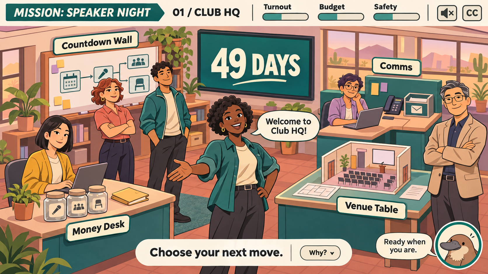
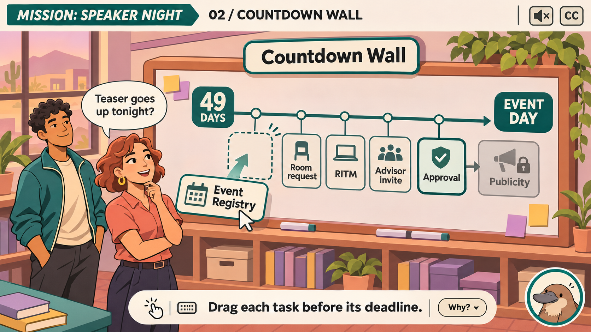
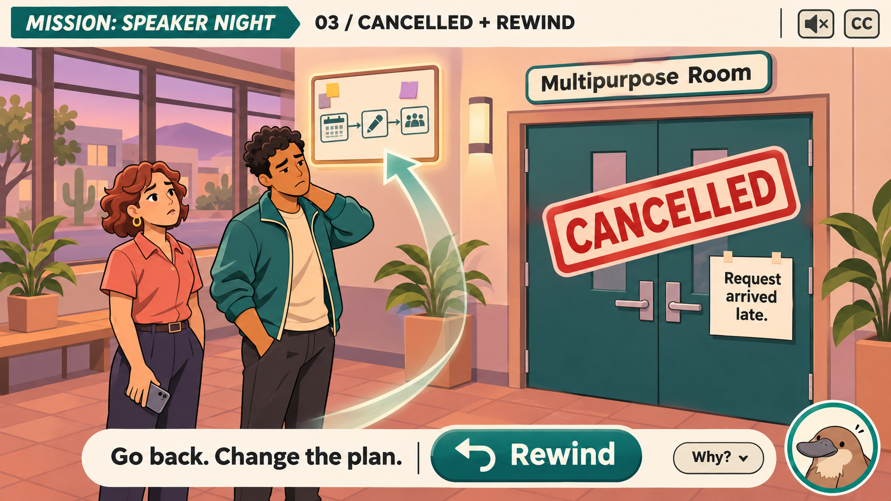
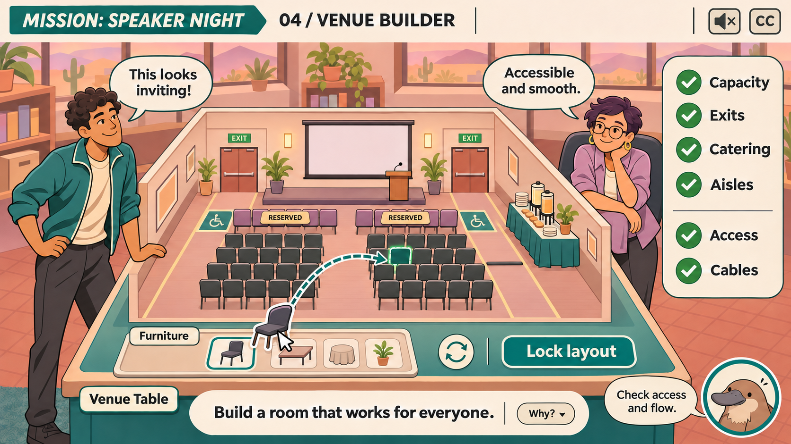
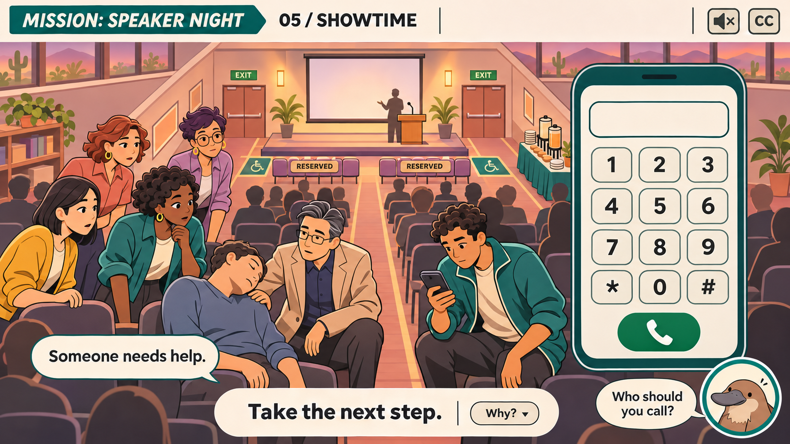
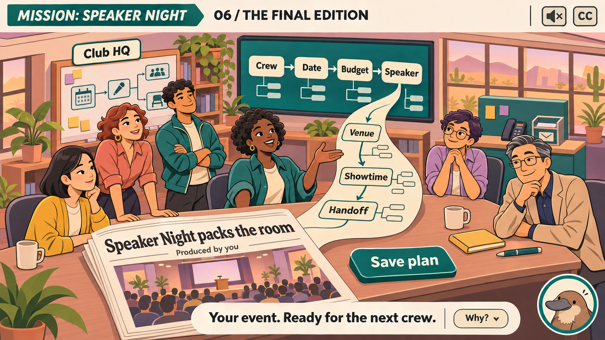

# P3 v1: six static storyboards

Owner approved all nine design recommendations before production. Six consistent PNG visual references are now ready for owner review. [Open the gallery](index.html), [read the visual review](REVIEW.md), [inspect the shared cast/style guide](STYLE_GUIDE.md), or [read the complete prompt set](prompts.json).

Method: built-in image generation, with HQ as the shared cast/style anchor; corrected Venue Builder also guides Showtime. Six generation calls and one targeted edit. PNGs are copied unchanged; see [manifest](manifest.json) for dimensions, provenance and SHA-256 values. The first Venue Builder pass remains only in local iterations.

These images fulfill the static storyboard preparation task. P3's owner visual-acceptance gate remains open; P4 implementation, merges and production release are not authorized by this delivery. All 33 rules remain unchanged. Thesis backup synchronization is pending.

### 01 — Club HQ

Meet the crew and choose among the four workstations.

### 02 — Countdown Wall

Drag tasks onto the timeline; publicity stays behind approval.

### 03 — Cancelled + Rewind

See a late-request consequence, then rewind and change the plan.

### 04 — Venue Builder

Build the room with six visible venue and accessibility checks.

### 05 — Showtime

Choose the next emergency action without a countdown.

### 06 — The Final Edition

Celebrate the event with a newspaper and its seven-stage flow.

